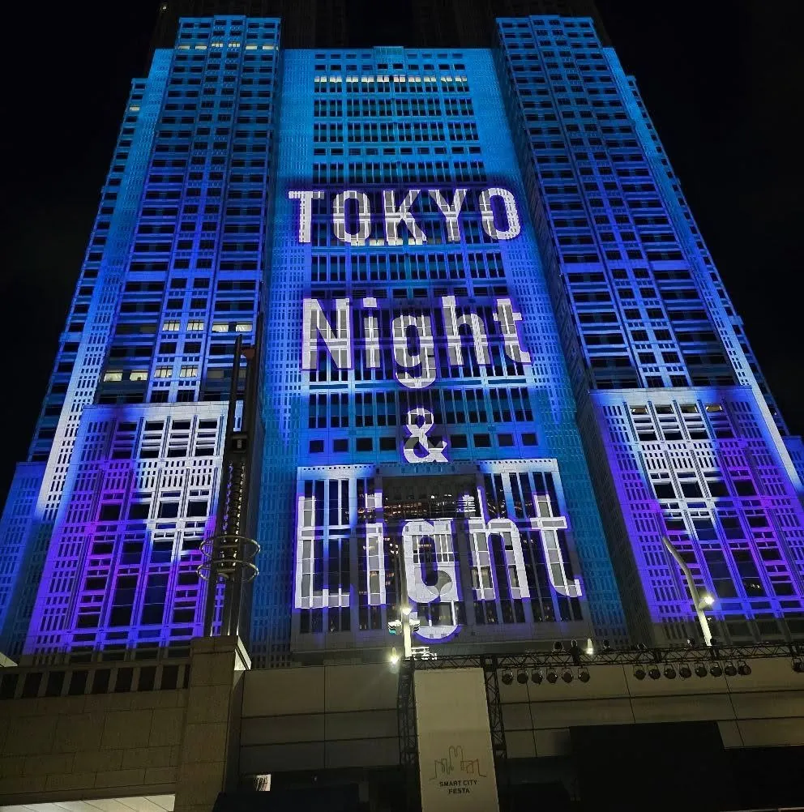

<div class="content-header">Over-Engineering a 21-Day Japan Trip with Agentic AI</div>

<div class="breadcrumbs">
  <a href="/">Home</a>
  <span class="separator">/</span>
  <a href="/blog/">Blog</a>
  <span class="separator">/</span>
  <span class="current">Agentic Japan Trip Planner</span>
</div>

<div style="margin-bottom: 24px; border-radius: 10px; overflow: hidden; border: 1px solid var(--border-color); background: radial-gradient(circle at center, #0f172a 0%, #020617 100%); box-shadow: 0 4px 12px rgba(0, 0, 0, 0.08); text-align: center;">
  
</div>

<div class="card" markdown="1">

# TL;WR ("Too Long, Won't Read"): The Up-Front Summary

This is going to be a long, granular teardown of how I used <a href="https://antigravity.google/" target="_blank" rel="noopener noreferrer">Google Antigravity (AGY)</a> as a full-stack travel logistics compiler, bilingual researcher, and rapid-prototyping Engineer for an upcoming three-week trip to Japan with my wife, Chee. Because I am a Tinkerer who cannot leave well enough alone, here is the executive summary up front so you can get the takeaway and bail out whenever you want:

* **The Core Thesis (Protecting Your System 2 Ration)**: In <a href="https://en.wikipedia.org/wiki/Thinking,_Fast_and_Slow" target="_blank" rel="noopener noreferrer">Daniel Kahneman's dual-process psychology</a>, humans only get roughly four hours of peak System 2 (slow, analytical, high-effort) cognitive bandwidth per day before mental fatigue sets in. If you burn three of those hours standing on a noisy Shinjuku train platform arguing with five browser tabs, translating Japanese holiday schedules, and figuring out which subway exit does not dump you a kilometer away from your target, you are robbing your vacation of System 1 (fast, effortless, present-in-the-moment) joy. We pre-compiled all the System 2 friction at home so we can spend three weeks in Japan actually existing together.
* **Bilingual Recon & The Tourist Rating Mirage**: My wife and I dumped a massive, organized list of things we wanted to do into a Google Sheet: rare mountain whisky distilleries, subterranean civil engineering flood temples, Sanrio theme parks, Lolita and Jirai-kei fashion flagships, historic naval ships, and hyper-specific anime pop-up shops. AGY queried official Japanese portals, municipal announcements, Google Maps, and native <a href="https://tabelog.com/" target="_blank" rel="noopener noreferrer">Tabelog (食べログ)</a> in both English and Japanese, cross-referencing tourist hype against harsh local scoring and auditing weekly shop closures (*Teikyūbi* / 定休日).
* **Life is a CTF (Defeating the "No Japanese Phone Number" & Credit Card Challenges)**: Earlier this year, I gave a talk at <a href="https://www.cackalackycon.org/" target="_blank" rel="noopener noreferrer">CackalackyCon</a> titled *Life is a CTF*, built around how I gamify complex real-world systems (*Figure, Play, Exploit*): figuring out the exact rules of the game, finding the most optimal path to the objective, and having fun while learning a ton along the way. Modern Japan events and experiences are heavily gated behind advance lotteries, timed entry drops, SMS verification that requires a local phone number, and 3D Secure 2.0 payment gateways. Treating the booking gauntlet like a Capture the Flag competition, AGY mapped 100% official, rule-abiding workarounds: buying a physical convention catalog at an Akihabara bookstore the day before to bypass the ticket line at Tokyo Big Sight, routing around domestic e+ SMS blocks via international allocations, and diagnosing why Chase Visa kept throwing cryptic browser errors on the Shinkansen portal while American Express sailed right through.
* **Dynamic Schedule Tetris & Parallel Swarms**: When we locked in immovable anchors (the surprise winning of the elusive Suntory Yamazaki Distillery lottery and booking a four-person cask tasting at Gaiaflow Shizuoka), or decided we only needed six to eight hours of sleep so we could leave the hotel earlier and linger longer, AGY refactored the surrounding 21 days on the fly. During our live ticket-booking sprint, I had AGY spin up parallel subagent swarms to update the backend spreadsheets and code in the background while keeping one priority thread live to guide my next purchase. This ensured I wasn't waiting for the AI to churn and could work in parallel alongside AGY to purchase passes and make reservations.
* **From Spreadsheet to Cloudflare Tunnel to Offline APK**: To review the 149 stops and 264 hour-by-hour rows on our phones away from the home network, AGY recommended me ephemeral <a href="https://developers.cloudflare.com/cloudflare-one/connections/connect-networks/" target="_blank" rel="noopener noreferrer">Cloudflare Quick Tunnels (`cloudflared`)</a>. What started as a simple calendar view evolved into a custom Progressive Web App (and eventual standalone Android `.apk`) featuring street-hugging OSRM routing, a local tile-caching proxy to bypass the need for API keys, 19 embedded SVG department store and theme park floor plans, yellow Japanese subway exit badges for underground dead zones, live phone GPS distance pills, and offline Kanji/Kana "Show to Staff / Taxi" cards.
* **The Human-in-the-Loop Imperative (Why AI is Not Magic)**: AGY is a force multiplier, not an infallible oracle. Left unchecked, it produced a 35-minute time overlap in Ginza, a backward chronological time jump in Kyoto, a non-existent 3:20 PM airport bus, and an overly tight transit window before our farewell Wagyu dinner that my wife and I caught during human review. You still have to trust but verify. This is also aided by this being a return trip, where we know enough to call AGY out on its errors.

If you want the actual war stories, the technical architecture, the anime pilgrimage rabbit holes, and the exact mistakes we caught along the way, grab a coffee (or prep a highball) and read on.

</div>

<div class="card" markdown="1">

# Table of Contents

* [1. The Tinkerer's Impulse: "Huh, Could This Work? Oh Snap, It Does Work!"](#1-the-tinkerers-impulse-huh-could-this-work-oh-snap-it-does-work)
* [2. Bilingual Recon: Tabelog Cross-Reference, Holiday Dominoes, and Ground Truth](#2-bilingual-recon-tabelog-cross-reference-holiday-dominoes-and-ground-truth)
  * [Built on Foundations, Not Flippant "One-Shot" Prompts](#built-on-foundations-not-flippant-one-shot-prompts)
  * [Calibrating for the Tourist Rating Mirage (Google Maps vs. Tabelog)](#calibrating-for-the-tourist-rating-mirage-google-maps-vs-tabelog)
  * [Auditing "Teikyūbi" (Regular Closures) and the National Holiday Shift](#auditing-teikybi-regular-closures-and-the-national-holiday-shift)
  * [The "Final Night" Anime Pop-Up Jackpot](#the-final-night-anime-pop-up-jackpot)
* [3. Life is a CTF: Lotteries, SMS Gates, and the Credit Card Boss Fight](#3-life-is-a-ctf-lotteries-sms-gates-and-the-credit-card-boss-fight)
  * [Boss Fight #1: The "No Japanese Phone Number" SMS Gate](#boss-fight-1-the-no-japanese-phone-number-sms-gate)
  * [Boss Fight #2: The 3D Secure Credit Card Gauntlet (AmEx vs. Chase Visa)](#boss-fight-2-the-3d-secure-credit-card-gauntlet-amex-vs-chase-visa)
  * [Boss Fight #3: Language-Gated Tours and "Show to Staff" Rumble Strips](#boss-fight-3-language-gated-tours-and-show-to-staff-rumble-strips)
* [4. Dynamic Schedule Tetris, Outfit Physics, and Parallel Swarms](#4-dynamic-schedule-tetris-outfit-physics-and-parallel-swarms)
  * ["We Only Need 6 to 8 Hours in the Hotel: Let's Pad the Ends"](#we-only-need-6-to-8-hours-in-the-hotel-lets-pad-the-ends)
  * [Outfit Physics & The Laundromat Schedule](#outfit-physics--the-laundromat-schedule)
  * [Firing Up Subagent Swarms During the Booking Sprint](#firing-up-subagent-swarms-during-the-booking-sprint)
* [5. The Engineering Stack: OAuth Sheets, Cloudflare Tunnels, and an Offline APK](#5-the-engineering-stack-oauth-sheets-cloudflare-tunnels-and-an-offline-apk)
  * [1. Respecting the Spouse's Spreadsheet (The OAuth Google Sheets Bridge)](#1-respecting-the-spouses-spreadsheet-the-oauth-google-sheets-bridge)
  * [2. The Cloudflare Tunnel "Aha!" Moment (And Fixing the Missing Map Tiles)](#2-the-cloudflare-tunnel-aha-moment-and-fixing-the-missing-map-tiles)
  * [3. Designing for Underground Dead Zones: 19 SVG Floor Plans & Subway Exit Badges](#3-designing-for-underground-dead-zones-19-svg-floor-plans--subway-exit-badges)
* [6. Keeping the Human in the Loop: Where the AI Stumbled](#6-keeping-the-human-in-the-loop-where-the-ai-stumbled)
  * [1. The Farewell Wagyu Dinner Pivot (Why Two Models + Two Humans Beat One)](#1-the-farewell-wagyu-dinner-pivot-why-two-models--two-humans-beat-one)
  * [2. The Final /boost Forensic Audit (15 Bugs Caught Before Minting)](#2-the-final-boost-forensic-audit-15-bugs-caught-before-minting)
* [7. The Takeaway: Using Tech to Protect the Human Experience](#7-the-takeaway-using-tech-to-protect-the-human-experience)

</div>

<div class="card" markdown="1">

# 1. The Tinkerer's Impulse: "Huh, Could This Work? Oh Snap, It Does Work!"

In my day job, I spend a lot of time talking to Engineers, Analysts, and SLED Directors about **Cognitive Ergonomics** and what I call **The Sunday at 2 AM Test**. When an Incident Responder is woken up at 2:00 AM on a Sunday because a critical link went dark, a good runbook does not hand them a 40-page philosophical essay. It hands them pre-verified commands, exact interface names, and physical-style **highway rumble strips** that keep them from driving off the road while their brain is still half-asleep.

Planning a three-week vacation to Japan with your spouse is obviously a lot more fun than triaging a network outage, but the cognitive mechanics are surprisingly similar.

My wife, Chee, and I are not "sit on a beach for seven days" travelers. We are explorers, wanderers, and unabashed nerds who are notoriously bad about getting sidetracked down interesting alleyways. When we sat down to draft our wish list for a 21-day late-autumn trip based out of a single hotel in Shinjuku (zero hotel-switching, luggage unpacked once), the scope looked like two completely different worlds colliding in the best way possible:

* **Chee's Must-Dos & Would-Likes**: Sanrio Puroland rope-drop, Cinnamoroll pop-up parks, Angelic Pretty and SHIBUYA109 fashion flagships, vintage Showa-era pudding and cream soda kissaten cafes, donut shops tucked inside Kagurazaka cobblestone alleys, autumn maple illuminations, and hunting down merchandise for her favorite shows.
* **My Must-Dos & Rabbit Holes**: Drawing raw whisky straight from a barrel with a copper valinch at Gaiaflow Shizuoka Distillery, touring the Suntory Yamazaki Distillery, descending 116 wet concrete stairs into the G-CANS underground flood-control temple in Saitama, touring the Memorial Ship *Mikasa* in Yokosuka, hitting the 72-hour earthquake survival simulator at Sona Area Tokyo, and tracking down exact real-world architectural landmarks and pop-ups for my own favorites.

If you hand that prompt to a standard web-based chatbot, you get generic tourist slop: a surface-level five-day list telling you to visit Senso-ji at noon, eat at Ichiran, and take a train that possibly no longer exists. That is the **Mirage** stage of the **5-Stage Operational Cognitive Decay Arc** (`Default → Static → Mirage → Atrophy → Brainrot`): the output looks formatted and confident on the screen, right up until you show up at a museum on a Tuesday after a national holiday and find the doors locked.

Instead of using a chatbot to generate a generic itinerary, Chee and I drafted the raw list of everything we cared about and handed it to Google Antigravity (AGY) inside my local workspace. I wanted to see what would happen if I treated an agentic coding environment like a bilingual Travel Agent and logistics compiler.

My exact thought process was pure curiosity: *"Huh, could this work? Wait... oh snap, it actually works."* This is the same curiosity I recommend all cybersecurity hopefuls have.

</div>

<div class="card" markdown="1">

# 2. Bilingual Recon: Tabelog Cross-Reference, Holiday Dominoes, and Ground Truth

The first reason an agentic harness beats a standard browser chat is tool execution across language boundaries. Most English-language travel blogs are an echo chamber of outdated Reddit threads and SEO aggregator sites. Ground truth in Japan lives on native Japanese domains (`.jp`), municipal construction portals, retail store X (Twitter) feeds, and Japanese reservation engines. Search "Ramen" and search `ラーメン` (or `らーめん`), even within Google Maps, and you will see entirely different results.

## Built on Foundations, Not Flippant "One-Shot" Prompts

To be completely clear: this was not flippant, two-sentence "plan my vacation" prompting. If you treat an agentic IDE like a magic 8-ball, you get magic 8-ball results.

Everything we did here was built directly on the engineering foundations I have been authoring in my [**GenAI for Tinkerers**](/genai-for-tinkerers/) series on `swalton.prof`: treating the model as an untrusted crate motor in [Module 1](/genai-for-tinkerers/Module1.html), plumbing clean, verified fuel lines in [Module 2](/genai-for-tinkerers/Module2.html), steering the harness with structured planning loops, subagent pit crews, and deterministic verification in [Module 3](/genai-for-tinkerers/Module3.html), and sizing local open-weight engines in [Module 4](/genai-for-tinkerers/Module4.html).

Instead of tossing a casual wish list over the fence, I approached our three-tier prioritized master list (`Must-Do`, `Would-Like-To-Do`, and `Fill-In`) using the exact same discipline I teach Practitioners:

* **Plumbing Clean Fuel First**: Before running a single web query, I loaded the project directory with 229 MB of official Japan National Tourism Organization (JNTO) reference PDFs (`Eat Japan.pdf`, `Tokyo Travel Guide.pdf`, `Information On Japanese Ports.pdf`, `Tourist Language Handbook.pdf`), our previous 2025 Japan trip calendar that Chee created, and our baseline proposal markdown.
* **An Essay-Length Engineering Specification (`ORIGINAL_REQUEST.md`)**: My initial kickoff and subsequent `/teamwork-preview` orchestration prompts were not one-liners; they compiled into a 216-line, 29 KB specification (`ORIGINAL_REQUEST.md`) broken into explicit functional requirements (`R1` through `R5`) and checkbox acceptance criteria (`- [ ]`). We explicitly instructed the harness to audit weekly regular closures (*Teikyūbi* / `定休日`), reconcile how the Monday Labor Thanksgiving National Holiday (`勤労感謝の日`) shifts museum closures to Tuesday, enforce a strict **Zero-Stranding Rule** on rural trains and ferries, and stage our 264-row `hour_by_hour_itinerary.md` locally before touching the live Google Sheet.
* **Liberal `/grill-me` Usage & Gemini 4 Argon Reasoning**: Running on **Gemini 4 Argon**, I leaned heavily on Antigravity's **`/grill-me`** slash command. Rather than leaving ambiguous gaps for the model to guess at, `/grill-me` puts the agent into a structured **decision-tree requirements interview**: it walks down each branch of the design tree one question at a time, presents concrete architectural trade-offs with a recommended choice, and resolves dependencies with you before executing a single change. A few examples pulled straight from our session history:
  * *Enforcing Scope & Creating `next_time.md`*: Early on, I wanted to explore rural Japanese *Akiya* (`空き家`, abandoned homes) and *Kominka* (`古民家`, restored timber folk houses) renovation towns like Mino (Gifu) and Minowa (Nagano), alongside the 8-kilometer Magome-Tsumago Nakasendo trail. Through our planning and audit loops, Gemini 4 Argon proved that 6-to-7-hour round-trip rural train transfers on the Nagaragawa Railway and JR Iida Line (plus a 4:30 PM November mountain sunset cutoff and bear-bell advisories) violated our **Zero-Stranding Rule** for a Tokyo-anchored trip. Rather than deleting that research, AGY routed all of those regional deep-dives into a standalone 1,100-line **`next_time.md`** expedition archive for our next visit, and swapped in zero-risk near-Tokyo *Kominka* architectural equivalents (like renovated Showa wooden buildings at Yanaka's HAGISO and the Edo-Tokyo Open Air Architectural Museum).
  * *Interrogating "Is This Possible or Overkill?"*: When we later transitioned from spreadsheets to building the mobile companion app, I didn't just ask for "a map." I prompted: *"Can you review the overall page for improvement? It is a lot of info. I would like a proposal and mock up image in nano banana before you make changes. I need support for both candybar and foldables and laptops... Can that also integrate Google Maps or just phone gps or show a gps icon of where we are at? End state is this app being downloaded to our phones as an APK that can be relied on almost exclusively... /grill-me I am not even sure if this is possible or overkill."* That decision-tree `/grill-me` interview is what separated what was genuinely feasible in a progressive web app from what needed native deep links.

At its core, none of this travel recon is mystical AI sorcery: it is the exact same workflow a meticulous human traveler does manually when scanning Google Maps, cross-referencing business hours, and dropping saved GPS pins, just executed at scale without the tab-switching fatigue.

## Calibrating for the Tourist Rating Mirage (Google Maps vs. Tabelog)

If you search Google Maps for restaurants in Tokyo, almost every tourist-facing spot in Shinjuku or Asakusa has a `4.7` or `4.8` star rating driven by travelers thrilled to be eating ramen in Japan. Locals do not use Google Maps to rate food; they use <a href="https://tabelog.com/" target="_blank" rel="noopener noreferrer">Tabelog (食べログ)</a>, which uses a weighted algorithm that grades like a notoriously tough engineering Professor:

* **`3.00-3.19`**: Standard neighborhood dining; perfectly fine.
* **`3.20-3.49`**: High-quality local favorite; worth a dedicated stop.
* **`3.50+`**: Elite tier (roughly the top 3% of all restaurants in Japan; expect queues or advance bookings).
* **`4.00+`**: Unicorn territory (less than 0.05% of venues nationwide).

I instructed AGY to pull **dual rating pairs** (both Google Maps and native Tabelog scores, with the scoring context attached) for every single cafe, bakery, curry house, and sushi spot across our 21 days. When we looked at Bondy Curry in Jinbocho (`Google 4.3 / Tabelog 3.78`, plus a strict **CASH ONLY** warning) or 365 Days Bakery near Yoyogi Park (`Tabelog 3.76`), we immediately knew we were looking at genuine local heavyweights rather than social media tourist traps.

## Auditing "Teikyūbi" (Regular Closures) and the National Holiday Shift

Japanese museums, gardens, markets, and independent shops operate on strict weekly closure schedules (*Teikyūbi* / 定休日), and they have a specific quirk that catches foreign travelers off guard: **when a regular Monday closure falls on a Japanese National Holiday, the venue stays open on Monday and shifts its closure to Tuesday**.

Our trip spans **Labor Thanksgiving Day (勤労感謝の日)** in late November. AGY audited every single stop around that holiday window:
* It verified that the Memorial Ship *Mikasa* in Yokosuka stays open 365 days a year (even on the Tuesday after a national holiday) with winter hours closing at 4:30 PM, and confirmed the final return ferry time from Sarushima Island (`16:00 sharp`) so we would never violate our **Zero-Stranding Rule**.
* It checked the Kadokawa Culture Museum in Tokorozawa Sakura Town (which closes on the 1st, 3rd, and 5th Tuesdays of the month) to confirm our Wednesday slot was 100% open.
* When we planned a coastal day trip to Numazu Port to see the frozen deep-sea coelacanths at the Numazu Deep Sea Aquarium, AGY discovered via Japanese local listings that a popular harbor burger spot from older guides had permanently closed in late 2025, seamlessly swapping in **ANCHOR BURGER / Repubrew** right at the port.
* For our morning train ride out to Sanrio Puroland at Tama-Center, AGY caught two hyper-specific details from Japanese railway announcements: first, that Keio Railway abolished its `Semi-Special Express` (`準特急`) train class back in March 2022 (consolidating into `Special Express` / `特急`), and second, that **Odakyu Tama-Center Station** right next door had just completed a brand-new **"Yume-Kawaii × Rainbow" station renewal** featuring 14 Sanrio characters led by Cinnamoroll! Even better, it warned us about a 3D vertical elevation trap outside the station: Parthenon Boulevard is a 2nd-floor elevated pedestrian deck, meaning if you do not take the stairs down to the 1st-floor street sidewalk at Cocolia, you will walk right over the 9 painted full-color Hello Kitty manhole covers without ever seeing them.

Catching that permanently closed Numazu burger shop and those updated rail/station configurations highlights a critical engineering reality: **a model's frozen pre-training dataset is a limitation, not ground truth**. If you rely on static model weights alone, you are flying on stale data. By combining `/boost`, adversarial verification passes, and parallel swarms of research subagents pulling **live telemetry** from Google Maps, native `.jp` portals, and municipal feeds, we could rapidly fact-check all 149 stops against current reality.

## The "Final Night" Anime Pop-Up Jackpot

Because my wife and I love specific anime series, as well as some older ones, that don't always get permanent flagship stores, I asked AGY late one night to sweep Japanese event calendars for any pop-ups overlapping our exact window. It chose `collabo-cafe.com`, Gamers, Kotobukiya, Medicos, and Houbunsha portals as those to check.

AGY came back with an alert for **Day 1 (Arrival Day)**: the **15th Anniversary Pop-Up Shop for *Senki Zesshou Symphogear XV*** on the 7th floor of AKIHABARA Gamers Main Store was ending on **the exact night our flight landed at Haneda**, and the store stayed open until 9:00 PM (`21:00 JST`).

Instead of wasting our first evening staring at the hotel ceiling fighting jet lag, AGY calculated the exact timeline from touchdown to customs, dropping our bags at the hotel in Shinjuku, hopping the JR Chuo-Sobu Line 17 minutes straight to Akihabara, hitting the final 90 minutes of the *Symphogear* pop-up (plus the final night of a *Touhou Project* event next door at Onoden 1F), and still making it back to Shinjuku by 8:40 PM for a comforting bowl of curry udon at Senkichi (`open until 23:00`) close walking distance to our hotel.

When I casually asked right before going to sleep if there were any events for *"Null meta and Kill Me Baby"*, AGY disambiguated `ぬるめた` (*Null Meta* by Kokamumo) from `ぬるぺた` (*Null Peta*), discovered that *Null Meta* had just been announced for a 2027 TV anime adaptation on October 18, and found an official **Theme Park Pop-Up Shop** running at the brand-new **Kirara & FUZ Official Store** on the 2nd floor of Shinjuku Marui Annex (a 12-minute walk from our hotel) strictly during the middle two weeks of our trip. It even flagged that visiting on Day 2 would be one day too early for the pop-up, and Day 20 would be three days too late, slotting it cleanly into our mid-trip Shinjuku windows and reminding us to bring a `¥110` rigid A4/B4 plastic document case from Daiso so the free purchase-bonus illustration cards wouldn't get bent in our bags.

</div>

<div class="card" markdown="1">

# 3. Life is a CTF: Lotteries, SMS Gates, and the Credit Card Boss Fight

One of the core frameworks I teach others and use in my own career is **Life is a CTF (Figure, Play, Exploit)**. You do not "hack" a system by breaking its laws; you read the manual more carefully than anyone else (*Figure*), test how the components interact (*Play*), and use 100% legitimate, official mechanics to bypass unnecessary friction (*Exploit*).

If you have not traveled to Japan, the biggest shock is how much of the country relies on time-gated digital reservations and advance lotteries that unintentionally lock out foreign visitors while also combatting bots.

## Boss Fight #1: The "No Japanese Phone Number" SMS Gate

Try to buy a ticket on domestic Japanese portals like **e+ (eplus)**, **Lawson Ticket (`l-tike.com`)**, or **Pia** from the United States, and you will hit a brick wall: mandatory SMS two-factor authentication requiring a domestic Japanese mobile number before you can even create an account.

Instead of giving up or turning to sketchy third-party scalpers, AGY audited every single ticketed event on our list and mapped out 100% official, zero-SMS paths:

1. **COMITIA 150 at Tokyo Big Sight (The Catalog-IS-the-Ticket)**: COMITIA is Japan's massive independent creator-owned manga convention (`コミティア`). Unlike corporate expos that use QR wristbands, COMITIA operates on a brilliant old-school rule: **there are no tickets**. Your admission badge is a physical, intact copy of ***Tia's Magazine* (`ティアズマガジン`)**, the thick phonebook-sized convention catalog. You can stand in a 60-minute line outside Tokyo Big Sight on Sunday morning to buy one at the door, *or* you can walk into Animate, COMIC ZIN, or Melonbooks in Akihabara the day before, pay `~¥1,500` in cash with zero phone number required, and walk straight past the Sunday ticket queue into the East Halls. AGY added that exact bookstore pickup right into our Saturday Akihabara route.
2. **Sanrio Puroland's Double-QR Trap & Parade PUROPASS**: AGY flagged that buying a Puroland admission ticket isn't enough: you *also* have to book a separate, free **Date/Time Entry Reservation (*Raijo Yoyaku* / `来場予約`)** QR code on Puroland's portal to get through the turnstiles. Meanwhile, paid front-row seating (`PUROPASS`) for the new *Quest of Wonders Parade* is locked exclusively inside the Japanese Lawson Ticket smartphone app (requiring a JP SMS number), whereas the `PUROPASS` for the *KAWAII KABUKI* theatrical show is sold right inside the park at a staffed 1st-floor counter that takes cash, credit cards, and Suica! AGY scripted our exact 10:00 AM rope-drop sequence: connect to `PUROLAND Wi-Fi` on the 1st floor (where signal is stronger than at the 3rd-floor turnstiles) to grab the free digital queue ticket (`Seiriken`) for Cinnamoroll in Room 301, step over to the 1F Food Court counter to buy the *KAWAII KABUKI* pass in person, and use the free viewing zone (`無料鑑賞エリア`) for the parade.
3. **Routing Around e+ via International Allocations (KKday, Fever, and Asoview!)**: When we went to book the **Sanrio Hotel Floria** immersive exhibition in Kabukicho and **Fuwafuwonder Cinnamoroll Park** at Tokyo Dome City Gallery AaMo (after our initial Saturday date sold out), the primary domestic portals pointed to e+ with Japanese SMS verification. While I was staring at the e+ screen, AGY searched the official organizer links and found that authorized international allocations were live on **KKday** and **Fever** (`feverup.com`), and that the **Yoyogi Park Forest of Lights** illumination accepted foreign credit cards directly on **Asoview!** (`asoview.com`) using an English guest checkout flow. Within twenty minutes, all of them were locked in and paid in USD/JPY with instant QR codes and zero SMS headaches. And when I say AGY did this while I was looking at the e+ screen, that is because I loaded up a swarm of agents to ensure links were given to me so I wasn't waiting while other backgrounds checks and verifications executed.

## Boss Fight #2: The 3D Secure Credit Card Gauntlet (AmEx vs. Chase Visa)

During our live booking session, we hit a classic piece of international travel friction: buying reserved Shinkansen bullet train seats on JR Central's not-so-**SmartEX** portal (for our trips to Shizuoka, Mishima/Numazu, and Kyoto).

I was using Chrome on my desktop, entered my primary travel card (a **Chase Visa**), and kept getting hit with a cryptic, unhelpful error pop-up right at checkout. I tried an Incognito window with all extensions disabled. Same error.

When I pasted a screenshot of the error into AGY, it immediately diagnosed the underlying payment architecture: Japanese rail and ticketing gateways (SmartEX, Webket, and several JR portals) enforce strict **EMV 3D Secure 2.0 (3DS2)** handshakes that frequently drop or auto-decline US-issued **Chase Visa** transactions before the bank even sends you a fraud text. AGY's immediate recommendation: *"Switch to an American Express card (AmEx SafeKey) or a Mastercard with 3DS2."*

I pulled out my **AmEx**, ran the exact same SmartEX checkout, and it sailed through on the very first click. We immediately locked in all six Shinkansen legs (including early-bird `Hayatoku-3` discounted reserved seats) and linked them to our digital Suica cards so we can just tap our phones through the bullet train gates.

## Boss Fight #3: Language-Gated Tours and "Show to Staff" Rumble Strips

Some of the coolest infrastructure in Japan has a strict operational rule: **safety briefings are conducted exclusively in Japanese**.

Take the **Metropolitan Area Outer Underground Discharge Channel (G-CANS / `首都圏外郭放水路`)** in Kasukabe, Saitama, widely known as the "Underground Temple." It is a colossal subterranean civil engineering marvel with 500-ton concrete pillars built to divert typhoon floodwaters. Its drainage pump station runs on over 40 MW of power (`~41.2 MW` / `56,000 horsepower` across four modified aircraft gas-turbine jet engines capable of pumping 200 metric tons of water per second), a metric where AI datacenters talk in 10s of MWs, so basically a small-to-medium data center's worth of mechanical output running on jet-engine turbines and backup generators. While the narrow catwalk and impeller courses require a fluent speaker or dedicated interpreter, non-Japanese speakers are permitted on the **Underground Temple Course (`地下神殿コース`)** we chose, provided you acknowledge that the live guide speaks only Japanese and use their multilingual audio guide app alongside our own rudimentary Japanese.

When I searched the Google Play Store on my US phone for the app, it wasn't there: it was region-locked or deprecated on US storefronts. AGY immediately pivoted, verifying the on-site browser/QR audio guide workflow, reminding us to keep Google Translate's Live Transcribe mode open on silent during the safety briefing to back up the rudimentary Japanese we already know, and scripting the exact Japanese phrase (`"Hai, daijōbu desu"` / `はい、大丈夫です`) to confirm we understood the laminated English safety card. It also cross-checked the physical requirements (116 wet concrete stairs; sandals, Crocs, or slick soles result in immediate refusal of entry with zero refund; surge tank floors have residual river silt) and automatically scheduled **Visit #5 at our neighborhood coin laundry** four hours after we get back to Shinjuku that evening.

We used that same **Cognitive Ergonomics** pattern when I booked back-to-back VR sessions at **TYFFONIUM Shinjuku**: Chee and I are doing the fantasy floral walkthrough (*FLORIA*) together at `16:40`, and then I am staying in the arena at `17:00` to do *Kaiju Haven VR* solo (since the 4D motion buggy would give Chee motion sickness (and me as well, but if you know me, you know that won't stop me), AGY mapped out a cozy tea lounge right upstairs in the Keio Plaza Hotel for her 25-minute break). So I wouldn't have to fumble through explaining a split party and back-to-back ticket IDs in broken Japanese at the check-in desk, AGY embedded a full-screen Kanji, Hiragana, and Romaji card right into the stop on my phone:

> **Show to Staff**: `16時40分の「フローリア（2名）」と、17時00分の「かいじゅうのすみかVR（1名）」を続けて予約しています。`  
> **Short Kana Read-Aloud**: `この２つを つづけて よやくしています！` (*"I have these two booked back-to-back!"*)

</div>

<div class="card" markdown="1">

# 4. Dynamic Schedule Tetris, Outfit Physics, and Parallel Swarms

A static paper itinerary shatters the moment reality changes. What blew me away about using AGY as a trip planner wasn't just the initial research; it was how fast it could refactor the entire 21-day dependency graph whenever our preferences evolved.

## "We Only Need 6 to 8 Hours in the Hotel: Let's Pad the Ends"

As we started locking in tickets, Chee and I realized two things about how we travel:
1. We do not need to lounge around the hotel until 10:00 AM. Six to eight hours of hotel sleep is plenty if waking up at 7:00 AM lets us beat the crowds at Suga Shrine (*Your Name* stairs) or Senso-ji and gives us breathing room to wander down side streets.
2. When we take a Shinkansen out to a mountain whisky distillery in Shizuoka (where we snagged one of the 4-person Cask Tasting slots at Gaiaflow) or down to Numazu Port and Kyoto, we do not want to sprint back to the train station in a panic.

Whenever I told AGY, *"We got the outbound Shinkansen booked, but let's pad the return trip by two hours so we can eat fresh Suruga Bay sakura-ebi tempura, watch the sunset over the water gate, and shop for souvenirs without rushing,"* or *"Drop the Haikyuu!! exhibit in Roppongi; we don't really care about that, let's do Mariko Mori's Wave UFO biofeedback pod at the Mori Art Museum at 2:00 PM before claiming a 52nd-floor window spot for the 4:28 PM sunset over Tokyo Tower,"* AGY didn't just edit a text bullet. It recalculated the walking geometry, verified the local bus headways (`Shizutetsu Justline Abe Line Route 111` from Stop #9 direct to `Okunoharakami`), checked the last entry times, and updated every downstream file.

When Maguro Mart in Nakano turned out to have no reservations available on Labor Thanksgiving, AGY refactored the whole evening in seconds into a zero-stress walk-in Bluefin Tuna feast right under the Godzilla head in Shinjuku (or Nakano's lantern-lit izakaya alleys), noting that both accept credit cards and require zero clock-watching. And for **American Thanksgiving (Thursday, Day 12)** after our coastal day trip to Kamakura and Enoshima, AGY helped us evaluate the seating windows at **Soul Food House** in Azabu-Juban (an authentic Southern and Cajun soul food restaurant in Tokyo run by American husband-and-wife expats David and LaTonya Whitaker), locking in a 9:00 PM feast of smoked turkey, BBQ spare ribs, mac and cheese, collard greens, and sweet potato pie, complete with a three-hour rest and dress-up buffer at the hotel beforehand.

## Outfit Physics & The Laundromat Schedule

Here is a detail no standard travel agent ever thinks about: **the physical geometry of your clothes versus the architecture of the venue**.

On Day 18, we booked a triple-header: riding the futuristic **Spaceship `EMERALDAS`** water bus (designed by anime legend Leiji Matsumoto, where we snagged the private VIP `Superior Compartment <Emerald>`) from Asakusa down the Sumida River to Odaiba, followed by **teamLab Planets TOKYO** at 2:30 PM, and **Fuwafuwonder Cinnamoroll Park** at 6:00 PM.

When I mentioned that I planned to wear zip-off cargo pants and Chee planned to wear a cute skirt, AGY immediately threw a yellow penalty flag across both the spreadsheet and the web app:
* **teamLab Planets** features rooms with **50cm (20-inch) knee-deep water** where you walk barefoot, *plus* two massive installations (*The Infinite Crystal Universe* and *Floating Flower Garden*) that have **360-degree mirrored glass floors** reflecting straight up.
* **Fuwafuwonder Cinnamoroll Park** at Gallery AaMo features a **12-meter giant cloud slide** that strictly requires shorts/pants coverage and flat, closed-toe athletic sneakers.

AGY embedded a dedicated **Outfit Plan Warning** directly onto Day 18: I unzip my cargo pants at the teamLab lockers, and Chee pairs bike/modesty shorts underneath her skirt with flat sneakers so she is 100% covered on both the mirrored floors and the giant cloud slide.

Even better, because we are packing light so we have suitcase room for goods and souvenirs, I told AGY about an unstaffed neighborhood coin laundry near our hotel that we used on our last trip, and AGY immediately ran with it. That is another great example of how keeping the human engaged produces a much better outcome than letting an AI guess on its own: instead of relying on lackluster, slow hotel combo washer-dryers that always get crowded at night, AGY verified the shop's exact commercial equipment (`4x 4.5kg washers at ¥200` and `3x 7kg gas dryers at ¥100 per 10 mins = ~¥500 per load`), flagged that it closes early at 6:00 PM on Sundays and national holidays (staying open until 10:00 PM Monday through Saturday), and scheduled **six recurring laundry stops every 3 to 4 days** paired with top-rated neighborhood udon and tonkatsu spots two minutes away. While the high-heat gas dryers do the work, we can grab dinner, wander Yoyogi neighborhoods, or just relax like we are locals.

## Firing Up Subagent Swarms During the Booking Sprint

During our Sunday afternoon booking marathon, I was moving fast: jumping from Fever to KKday to SmartEX to TableCheck. Waiting 60 seconds after every single ticket confirmation for a single agent thread to update 5,000 lines of Markdown, recalculate JSON map coordinates, and push OAuth updates to Google Sheets would have killed my momentum.

So I told AGY: *"Use a swarm to process the backend stuff and 1 priority one to tell me the next step so I am waiting less."*

Using Antigravity's subagent architecture, the main orchestrator immediately triaged my next reservation target in seconds (handing me the exact URL, time slot recommendation, and credit card guidance) while dispatching background worker subagents to update `todo.md`, `current_plans.md`, `hour_by_hour_itinerary.md`, and the live Google Sheet asynchronously. It felt like sitting in a SOC command center with a team of Junior Analysts updating the incident ticket while the Lead Engineer stayed on the bridge with me.

</div>

<div class="card" markdown="1">

# 5. The Engineering Stack: OAuth Sheets, Cloudflare Tunnels, and an Offline APK

A pile of Markdown files on my laptop does not help Chee and me when we are standing three stories underground in Shinjuku Station or sitting on a couch in another room reviewing the plan on our phones. Here is the actual engineering pipeline we built to turn text into a pocket companion.

```
+--------------------------------------------------------------------------+
|                 1. COLLABORATIVE SOURCE OF TRUTH                         |
|  - Live Google Sheet (20-Col Master Schedule + Chee's Color-Coded Tab)   |
|  - Cross-Linked '=HYPERLINK("#gid=...")' to Tickets & Special Notes Tab  |
|  - Python OAuth Bridge (gsheets_helper.py) w/ Post-Trip Token Revocation |
+------------------------------------+-------------------------------------+
                                     |
                                     v
+--------------------------------------------------------------------------+
|                 2. LOCAL COMPILER & GEOMETRY ENGINE                      |
|  - 21 Days | 149 Geo-Routed Stops | 264 Hour-by-Hour Rows                |
|  - OSRM Street-Hugging Polylines + Great-Circle Rail/Boat Curves         |
|  - 19 Custom SVG Architectural Floor Plans (build_floor_plans.py)        |
+------------------------------------+-------------------------------------+
                                     |
                                     v
+--------------------------------------------------------------------------+
|                 3. EPHEMERAL CLOUDFLARE TUNNEL & TILE PROXY              |
|  - Local Python Server (itinerary_map_app.py :8765)                      |
|  - Server-Side Map Tile Proxy (.gtile_cache) for Remote Mobile Rendering |
|  - Zero-Config Quick Tunnel (cloudflared tunnel --url localhost:8765)    |
+------------------------------------+-------------------------------------+
                                     |
                                     v
+--------------------------------------------------------------------------+
|                 4. OFFLINE-FIRST PWA & ANDROID APK                       |
|  - Adaptive UI: Candybar Phone (<640px), Foldable 50/50, Laptop Split    |
|  - Live Phone GPS ('You Are Here' + Haversine Distance Pills)            |
|  - Yellow Subway Exit Badges + Offline Kanji 'Show to Staff/Taxi' Cards  |
+--------------------------------------------------------------------------+
```

## 1. Respecting the Spouse's Spreadsheet (The OAuth Google Sheets Bridge)

Chee had built a color-coded tab in our shared Google Sheet organizing her ideas into **Must-Do** (green `#B6D7A8`), **Would-Like-To-Do** (yellow `#FFD966`), and **Fill-In** (orange `#F9CB9C`). Rule #1 of marriage and systems engineering: **never break your user's existing interface**.

Instead of overwriting her sheet, AGY wrote a Python OAuth helper (`gsheets_helper.py`) that preserved 100% of her original column and hex colors, added a non-destructive Column B (`Scheduled Day / Status & Link`), and injected live internal `=HYPERLINK("#gid=...", ...)` formulas so clicking any item in her wish list jumped straight to that day's row in the 21-day master comparison tab. When she added a link to a pop-up shop in Akihabara directly into the Google Sheet, I just told AGY to run the helper script, pull her live edit down into `sheet_state.json`, and wire the exact 5th-floor Kotobukiya coordinates into Day 7. And because I am a security guy who hates lingering credentials, AGY scheduled a post-trip task (`python gsheets_helper.py --cleanup`) to revoke and delete the OAuth token the day after we fly home.

## 2. The Cloudflare Tunnel "Aha!" Moment (And Fixing the Missing Map Tiles)

Once AGY compiled the interactive web app (`itinerary_map_app.py`), I wanted to view it on my phone and show it to Chee while away from my desktop. AGY suggested spinning up a temporary **Cloudflare Quick Tunnel** (`cloudflared.exe tunnel --url http://localhost:8080`). With a single command and zero router port-forwarding, my local Python server was accessible over an encrypted `*.trycloudflare.com` HTTPS URL from anywhere.

Then we hit a classic real-world bug: when I opened the tunnel on my phone, the timeline loaded, **but the Map tiles were completely blank and asking for an API key**.

I told AGY: *"The map isn't showing the map tiles. Thought it would be proxied off my desktop via Google Maps."*

AGY immediately inspected the client-side Leaflet requests, saw that direct mobile browser requests to external tile servers were failing or getting blocked over the tunnel, and re-architected the local Python server to act as a **server-side caching tile proxy** (`/tiles/{mode}/{z}/{x}/{y}.png`, backed by an in-memory and disk cache in `.gtile_cache/`). Suddenly, not only did the satellite and hybrid street tiles render over the Cloudflare tunnel on our phones, but every tile we viewed was automatically cached to disk for offline bundling.

## 3. Designing for Underground Dead Zones: 19 SVG Floor Plans & Subway Exit Badges

Here is a physical reality of Tokyo that breaks standard map apps: **GPS does not work three stories underground in Shinjuku Station, and Google Maps cannot see inside a 10-story vertical department store in Akihabara or Shibuya**! Shoot, GPS struggles just standing in the middle of Shinjuku with all the steel around you.

When I ran `/grill-me` with AGY and asked it to generate visual UI mockups first (using Nano Banana image generation so we could align on the layout for candybar phones, unfolded foldables in 50/50 split view, and laptops before touching the code), we engineered the app specifically for zero-signal indoor survival:

* **19 Embedded SVG Architectural Blueprints**: AGY wrote `build_floor_plans.py` to generate 19 custom, high-contrast SVG floor plans and park maps embedded directly into the HTML payload (`0ms` load time, zero cell signal required). Whether we are inside **SHIBUYA109** (`B2F-8F`, highlighting `7F` as *"Chee's #1 Floor: LIZ LISA, Secret Honey, Ank Rouge"*), **Sanrio Puroland** (`1F-4F`), **Akihabara Radio Kaikan** (`1F-10F`), **Laforet Harajuku** (`B1.5F` Angelic Pretty), **Nakano Broadway**, or **Tokyo Big Sight**, tapping `📐 View Indoor Floor Plan` pops up the exact floor-by-floor directory and tactical route.
* **High-Visibility Yellow Subway Exit Badges**: In Japanese train stations, all exit signage is bright yellow with black text (`🚪 Exit A1 / 電気街南口`). AGY parsed every transit leg in our itinerary, extracted the exact station gate, track number, and exit code, and rendered them as yellow station-sign badges directly on the timeline connector pills. When GPS drifts underground, you ignore the blue dot and follow the yellow signs.
* **Live GPS Distance, Google Maps Deep-Link Pins, & Offline Taxi Cards**: Above ground, tapping `📍 Locate Me` turns on `navigator.geolocation.watchPosition`, rendering a pulsing blue dot on the map and calculating live Haversine distance badges (`📍 320m away`) on every stop card for the active day (another example of me learning while tinkering is that I didn't know Haversine was the term used for distance on a sphere, something else AGY was happy to elucidate on!). Just as importantly, every single one of those 149 stops has its verified GPS coordinates and a 1-tap `🗺️ Google Maps` deep link baked right into the card. Once we are on the ground in Japan, navigating from stop to stop is no different than a traveler who manually saved GPS pins and relies on live Google Maps for up-to-the-minute walking directions, train platform changes, and business hours. And if we hop in a cab or need help at a station window, tapping `🗣️ Show JP / Translate` opens a giant-print, offline Japanese card (`この場所までお願いします` + the Japanese venue name and address) alongside a 1-tap deep link into the native Google Translate app.

</div>

<div class="card" markdown="1">

# 6. Keeping the Human in the Loop: Where the AI Stumbled

I never want to hold up GenAI or agentic workflows as infallible magic. In my teaching on `swalton.prof`, I hammer home the warning that blindly trusting an LLM without inspecting the wire leads straight to **Atrophy** and **Brainrot**. Even with multi-agent verification, Chee and I reviewed every single day line-by-line, and that human review caught real flaws.

## 1. The Farewell Wagyu Dinner Pivot (Why Two Models + Two Humans Beat One)

On our final night in Tokyo (Day 20), we wanted a legendary A5 Wagyu Sukiyaki farewell dinner. Initially, the itinerary had us watching the evening projection mapping show at the Tokyo Metropolitan Government Building (Tochō) in West Shinjuku and then trekking across the massive Shinjuku station complex to a department store restaurant for a strict reservation window.

As I looked at the map and the walking times, my operational spider-sense went off: *getting caught in Friday night Shinjuku foot traffic or taking a wrong turn in the underground concourse right before an expensive, non-refundable A5 Wagyu reservation is a recipe for stress.*

While cross-checking options in a separate browser session with Gemini Argon and bringing the findings back into AGY for evaluation, we uncovered a massively superior play: **Ningyocho Imahan Banyoh (`今半万窯 新宿サザンタワー店`)**, located on the 4th floor of the Odakyu Southern Tower.

Why was that a massive upgrade?
* **Distance**: Odakyu Southern Tower is a much easier walk from our hotel. Zero train transfers, zero foot-traffic stranding risk.
* **Culinary Upgrade**: Unlike standard branches where you have to choose between grilled steak *or* sukiyaki, the flagship *Banyoh* branch features a dedicated **Tamura Beef "Takumi" Charcoal Master Course (`《田村牛》炭匠コース 極上ロース`)** that serves *both* Bincho-tan white-charcoal hearth-grilled A5 steak *and* full kimono-served table-side A5 Sukiyaki in a private table-and-chair room (`椅子席 個室`).
* **Schedule De-Confliction**: Because the Tochō projection mapping show runs every night just a short walk away, we moved the projection show to an earlier evening (Day 11 right after our TYFFONIUM VR session across the skybridge), leaving our final Friday evening completely relaxed. Something that AGY was more than happy to quickly adjust.

## 2. The Final `/boost` Forensic Audit (15 Bugs Caught Before Minting)

Before locking the app for offline export, I told AGY to run a full line-by-line chronological and data-integrity audit across all 21 days, 149 map stops, 264 hour-by-hour spreadsheet rows, and 16 confirmed bookings, and log every single discrepancy in `itinerary_issues_audit.md`.

That adversarial self-audit caught **15 subtle bugs** that had crept in during our rapid-fire edits:
* **A Backward Time Jump in Kyoto (Day 17)**: After our morning tour at Suntory Yamazaki Distillery, the spreadsheet had us eating lunch at Kyoto Station from `14:05-15:05` and taking a train at `15:15-15:20`, which **jumped backward in time** into our `14:40-16:15` Fushimi Inari Taisha block! The audit tightened lunch to `13:57-14:30` and aligned the train so the afternoon flowed seamlessly into Fushimi Inari and our *K-ON!* pilgrimage at JEUGIA Sanjo (`"10GIA"` music store where Yui buys her Gibson Les Paul "Giita").
* **A 35-Minute Overlap in Ginza (Day 13)**: In the spreadsheet, Ginza Itoya (`11:35-12:35`) overlapped Sanrio World GINZA (`12:00-13:05`) by 35 minutes, and the *Madoka Magica* glass atrium stop at the Tokyo International Forum was out of geographic order.
* **The Non-Existent 3:20 PM Airport Bus (Day 21)**: One tab still listed a `15:20 JST` Airport Limousine Bus pickup from our hotel curb to Haneda Terminal 3. When the audit cross-checked the official Tokyo Airport Transport timetable, **no `15:20` bus existed**: there was a two-hour afternoon gap between the **`14:55` curb pickup** (arriving Haneda at `16:10`) and the `16:55` bus (which would arrive at `18:10`, way too late for an early-evening international flight!). Catching that single timestamp discrepancy at home saved us from standing on a curb on departure day watching a phantom bus never arrive.
* **10 Broken Regex Strings in the Spreadsheet**: An earlier script split on parentheses had left truncated URL fragments inside 10 venue cells in `sheet_state.json`, which the audit automatically repaired with clean `=HYPERLINK(...)` formulas.

> [!TIP]
> **Field Notes from the Server Room Floor**
>
> * **Pre-Compile Your System 2 Decisions**: Whether you are writing a disaster recovery runbook for a SLED network or planning a 21-day international trip, never force a tired human in the field to do real-time research under clock pressure. Do the bilingual verification, exit-number mapping, and backup-route math ahead of time so field execution stays in System 1.
> * **Respect the Human Interface**: If your partner (or your Tier 1 Analyst team) works out of a color-coded Google Sheet, build your automation to read and write cleanly to their sheet rather than forcing them into a raw CLI.
> * **Always Run an Adversarial Audit Pass**: When you make 50 dynamic schedule changes over a weekend, state drift is guaranteed. Force your agentic harness to run a deterministic cross-file audit (`JSON` vs. `Markdown` vs. `Live Sheet`) before you commit to things.

</div>

<div class="card" markdown="1">

# 7. The Takeaway: Using Tech to Protect the Human Experience

Someone looking at our 149-stop map app, 19 embedded SVG floor plans, scheduled coin-laundry matrix, and Kana check-in cards might laugh and say, *"Steven, you turned a vacation into a military operation."*

Actually, it is the exact opposite.

Nothing ruins the magic of wandering around a foreign country faster than the low-grade anxiety of wondering if you just missed the last rural bus out of a mountain valley, finding out the museum you traveled an hour to see closed 20 minutes ago, or spending your evening staring at a smartphone screen trying to figure out which credit card won't get rejected by a train kiosk.

By treating Google Antigravity like a tirelessly enthusiastic, incredibly forgiving, logistics Engineer and Trip Coordinator extraordinaire, Chee and I got to have the best of both worlds. Every single immovable anchor is locked in and paid for. Every subway exit, locker floor, dress-code quirk, and cash-only curry shop has a rumble strip built right into our phones. And because all the alternate routes and operating windows are already cached offline in our pockets, we have **total freedom to linger, get sidetracked, duck into a random retro arcade, or sit in a park eating crepes**, knowing that with one tap on our screen, we can see exactly how far we are from the next stop and which train gets us home.

That is what good engineering is supposed to do: handle the complexity under the hood so the humans in the cabin can just enjoy the ride.

</div>
