<div class="content-header">Lab 3A: Windows Firewall DNS Telemetry Triage Refactoring</div>

<div class="breadcrumbs">
  <a href="/">Home</a>
  <span class="separator">/</span>
  <a href="/genai-for-tinkerers/">GenAI for Tinkerers</a>
  <span class="separator">/</span>
  <a href="/genai-for-tinkerers/Module3.html">Module 3</a>
  <span class="separator">/</span>
  <span class="current">Lab 3A</span>
</div>

<div class="card" markdown="1">

# Lab 3A: Windows Firewall DNS Telemetry Triage Refactoring

**Module:** [Module 3: Agentic IDEs & AI Pair Programming](/genai-for-tinkerers/Module3.html)  
**Target Environment:** Windows, macOS, or Linux (Workstation, VM, or Container Sandbox) with Antigravity IDE  
**Estimated Completion Time:** 45 Minutes  

* TOC
{:toc}

---

## Lab Objectives

1. **Operate in Read-Only Planning Mode**: Audit a fragile legacy Python log triage script (`legacy_log_triage.py`) without modifying any source files or running destructive write tools.
2. **Author and Review Architectural Plans**: Inspect and approve an agent-generated `implementation_plan.md` artifact detailing proposed structural changes, typed dataclasses, and verification strategies.
3. **Supervise Autonomous Execution**: Transition the agent into Execution Mode to implement atomic code replacements (`replace_file_content`) and modernize the parser.
4. **Observe Automated Self-Correction**: Watch the agent execute the script in the terminal (`python legacy_log_triage.py sample_pfirewall.log`), inspect the failure/output, formulate fixes, and iterate autonomously until all unauthorized DNS queries are correctly identified and alerted.
5. **Inspect the Walkthrough Deliverable**: Review the finalized `walkthrough.md` report containing verification evidence and passing execution logs.

---

## Scenario Overview

You have assumed the role of a Systems Administrator / SOC Analyst inheriting a fragile, monolithic Python script (`legacy_log_triage.py`) used by your operations team to parse [Windows Defender Firewall logs](https://learn.microsoft.com/en-us/windows/security/operating-system-security/network-security/windows-firewall/configure-logging) (`pfirewall.log`) and flag suspicious network connections.

Your organization enforces a strict internal DNS policy:
* Outbound DNS resolution must route only to authorized baseline resolvers: **`8.8.8.8`** over **UDP/53** (governed by [RFC 1035](https://www.rfc-editor.org/rfc/rfc1035)) and **TCP/53** (per [RFC 7766](https://www.rfc-editor.org/rfc/rfc7766)).
* Outbound queries directed to unauthorized resolvers (such as **`8.8.4.4`** over **UDP/53** or **TCP/53**) represent unauthorized resolver usage, policy violations, or potential DNS exfiltration, and must trigger a triage alert.

The script currently functions under narrow conditions, but suffers from severe technical debt:
* **Brittle Tokenization**: It uses naive whitespace splitting (`line.split(" ")`) and hardcoded list indices instead of typed schemas.
* **Header Comment Crashes**: It crashes immediately when encountering W3C header comments starting with `#` (`#Version: 1.5`, `#Fields:`).
* **Bare Exception Handling**: It relies on a bare `except:` block that masks syntax errors, missing files, and permission exceptions.
* **Incomplete Triage Logic**: It blindly checks only for `DROP` actions, completely failing to detect allowed outbound traffic to unauthorized DNS destinations (such as `8.8.4.4:53`).

You will use Antigravity IDE's **Planning Mode** to audit the codebase, author an `implementation_plan.md`, approve the refactoring blueprint, supervise the agent as it autonomously refactors the script and resolves execution failures, and inspect the resulting `walkthrough.md`.

---

> [!NOTE]
> **Operational Guidance: Understanding Tool Access, Sandboxes & Autonomy**
> 
> Security boundaries in agentic engineering are never purely black and white: they depend entirely on understanding what tools your agent possesses and what filesystem or network access is actually granted.
> 
> * **Know Your Access Boundaries**: Running inside Windows Subsystem for Linux (WSL) keeps package dependencies organized, but remember that WSL mounts host drives (`/mnt/c/`) and shares host network routes by default. Similarly, tools like Hermes or Docker containers offer dedicated sandbox modes right on your local machine, but they are only as effective as the bind mounts and environment variables you configure. Always verify what directories, ports, and credentials an agent can touch before letting it run.
> * **Calibrate Autonomy with Familiarity**: There is certainly a place for fully autonomous solutions, but that level of trust comes only with hands-on familiarity that this course is designed to build. When starting out with new agentic harnesses or models, keep the Human-in-the-Loop permission gate active. Review proposed terminal commands and atomic diffs rather than blindly auto-approving them.
> * **Defensive Operational Habits**: Whether you pair with an agent directly on bare metal or inside an isolated Virtual Machine (VM), build defensive muscle memory: work in dedicated git scratch branches so any bad change can be reverted instantly, keep secrets (`.env`, private keys) quarantined away from project folders, and test new agentic skills in clean, low-stakes workspaces first.

---

## Starter Files

The lab files are staged in this directory:
* `legacy_log_triage.py`: The legacy log triage script.
* `sample_pfirewall.log`: Bundled sample Windows Firewall log containing standard header comments, normal traffic, dropped packets, and the 4 DNS test combinations.

---

## Step-by-Step Execution Guide

### Step 1: Stage the Legacy Workspace in Your Sandbox

You can complete this lab using either the pre-packaged sample log or live-captured firewall logs:

#### Option A: Bundled Sample Log (Instant / Cross-Platform)
Use the included `sample_pfirewall.log`. This option requires no administrative privileges and works immediately across Windows, macOS, Linux, and WSL environments.

If working inside this repository, navigate directly to this lab directory:
```bash
cd genai-for-tinkerers/labs/module3/lab3a
```
Alternatively, copy the lab directory to an isolated sandbox:
```bash
mkdir -p ~/labs/lab3a-refactoring
cp sample_pfirewall.log legacy_log_triage.py ~/labs/lab3a-refactoring/
cd ~/labs/lab3a-refactoring
```

> [!WARNING]
> **The Golden Rule of Agentic Engineering: ALWAYS MAKE A BACKUP!**  
> Notice that in this lab, we dive straight into letting the agent refactor `legacy_log_triage.py` in-place. If you didn't create a backup copy before starting... your only backup is whatever code is published on this lab website!  
> In any real-world project, **never let an agent perform in-place edits on uncommitted files without a backup or a clean git branch**. Always run `git checkout -b feature/triage-refactor` or make a manual copy (`cp legacy_log_triage.py legacy_log_triage.py.bak`) so you have an instant rollback safety net if an autonomous edit goes sideways.

#### Option B: Live Capture on Windows (PowerShell / CMD & nslookup)
If you are working on a native Windows machine (or Windows on ARM / VM) and wish to generate authentic firewall logs:

1. **Enable Windows Firewall Logging** (Run PowerShell as Administrator):
   ```powershell
   Set-NetFirewallProfile -Profile Domain,Public,Private -LogAllowed True -LogBlocked True -LogFileName "$env:SystemRoot\System32\LogFiles\Firewall\pfirewall.log"
   ```
   *(Or via Command Prompt as Administrator: `netsh advfirewall set allprofiles logging allowedconnections enable` and `netsh advfirewall set allprofiles logging droppedconnections enable`)*

2. **Generate the 4 DNS Test Combinations**:
   Open PowerShell or Command Prompt and execute queries against both resolvers across both UDP and TCP:

   *In PowerShell:*
   ```powershell
   # 1. Authorized DNS Query (UDP/53 baseline)
   nslookup google.com 8.8.8.8

   # 2. Authorized DNS Query over TCP (TCP/53 virtual circuit)
   nslookup -vc google.com 8.8.8.8

   # 3. Unauthorized DNS Query (UDP/53 alert condition)
   nslookup google.com 8.8.4.4

   # 4. Unauthorized DNS Query over TCP (TCP/53 virtual circuit alert condition)
   nslookup -vc google.com 8.8.4.4
   ```

   *Or in Command Prompt (CMD):*
   ```cmd
   :: 1. Authorized DNS Query (UDP/53 baseline)
   nslookup google.com 8.8.8.8

   :: 2. Authorized DNS Query over TCP (TCP/53 virtual circuit)
   nslookup -vc google.com 8.8.8.8

   :: 3. Unauthorized DNS Query (UDP/53 alert condition)
   nslookup google.com 8.8.4.4

   :: 4. Unauthorized DNS Query over TCP (TCP/53 virtual circuit alert condition)
   nslookup -vc google.com 8.8.4.4
   ```

3. **Copy the Generated Log**:
   Copy the log file into your lab directory:

   *From PowerShell (Administrator):*
   ```powershell
   Copy-Item "$env:SystemRoot\System32\LogFiles\Firewall\pfirewall.log" .\sample_pfirewall.log
   ```

   *From Command Prompt (Administrator):*
   ```cmd
   copy "%SystemRoot%\System32\LogFiles\Firewall\pfirewall.log" .\sample_pfirewall.log
   ```

*(Note: Students on macOS or Linux can stand up a Windows on ARM virtual machine to capture these logs, or simply rely on Option A.)*

#### Baseline Verification
Run the legacy script directly against the sample log to observe its failure:
```bash
python legacy_log_triage.py sample_pfirewall.log
```

Observe the console output:
```text
An error occurred reading logs
Flagged 0 suspicious entries.
```

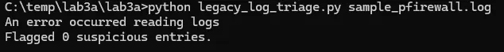{: style="display: block; width: 100%; max-width: 650px; margin: 1.25rem auto 1.5rem auto; border-radius: 8px; box-shadow: 0 0 25px rgba(0, 255, 170, 0.15);" }

**Why did it fail?**
The legacy script uses naive whitespace splitting (`line.split(" ")`) and hardcoded column indices (`parts[6]`). When it reaches the W3C header comments (`#Version: 1.5`, `#Fields:`), it raises an unhandled `IndexError`. The bare `except:` block masks the exception and prints an error message, returning zero flagged entries and completely missing the unauthorized queries to `8.8.4.4:53`!

---

### Step 2: Engage Planning Mode & Collaborative Interview (/plan & /grill-me)

1. Launch **Antigravity CLI** (`agy`) inside your lab directory (or open the folder in Antigravity IDE). When prompted, select `> Yes, I trust this folder` to grant workspace access:

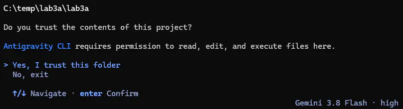{: style="display: block; width: 100%; max-width: 650px; margin: 1.25rem auto 1.5rem auto; border-radius: 8px; box-shadow: 0 0 25px rgba(0, 255, 170, 0.15);" }

2. In the interface, switch to **Planning Mode**. In the AGY CLI, you can activate Planning Mode either by typing the slash command **`/plan`** or by pressing **`Shift+Tab`** to cycle through modes (which displays `Plan mode: research & plan only` and sets the `plan` badge):

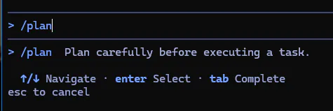{: style="display: block; width: 100%; max-width: 500px; margin: 1rem auto; border-radius: 8px; box-shadow: 0 0 25px rgba(0, 255, 170, 0.15);" }

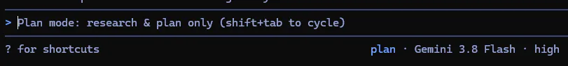{: style="display: block; width: 100%; max-width: 650px; margin: 1rem auto 1.5rem auto; border-radius: 8px; box-shadow: 0 0 25px rgba(0, 255, 170, 0.15);" }

3. Issue the concise refactoring prompt with **`/grill-me`**:
   ```text
   /plan /grill-me Audit legacy_log_triage.py. It fails when running against sample_pfirewall.log. I want to refactor it to handle Windows Firewall logs and flag unauthorized DNS queries.
   ```

4. **The Human-in-the-Loop Safety Gate (Terminal Permission Options)**:
   As the agent begins inspecting your workspace, it will request permission before executing any terminal command (such as `cmd.exe /c "dir /b"` to check what files exist):

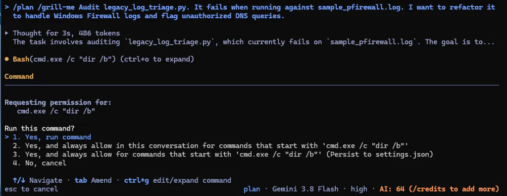{: style="display: block; width: 100%; max-width: 650px; margin: 1.25rem auto 1.5rem auto; border-radius: 8px; box-shadow: 0 0 25px rgba(0, 255, 170, 0.15);" }

   You are presented with 4 permission levels:
   * **`1. Yes, run command` (Single-Use Approval)**: Authorizes only this specific command execution. If the agent runs the command again, it will pause and prompt for permission. Ideal for one-off or unfamiliar commands.
   * **`2. Yes, and always allow in this conversation for commands that start with '...'` (Session Allowlist)**: Authorizes this command and auto-approves any future command in this *active session* matching that prefix without saving permanent changes. Ideal for repetitive read-only inspections.
   * **`3. Yes, and always allow for commands that start with '...' (Persist to settings.json)` (Permanent Allowlist)**: Authorizes the command and writes a persistent allowlist rule to your configuration file (`settings.json`), auto-approving matching commands in all future sessions.
   * **`4. No, cancel` (Deny / Abort)**: Blocks command execution and informs the agent that the action was rejected, causing it to pivot to an alternative approach.

   *(For harmless inspection commands like `dir /b`, choose **`1`** or **`2`** to allow the agent to proceed.)*

5. **Participate in the `/grill-me` Interview**:
   Instead of requiring you to write a massive, 20-line specification upfront, the `/grill-me` workflow flips the dynamic: the agent presents interactive multiple-choice questions directly in your terminal to establish architectural requirements one decision at a time:

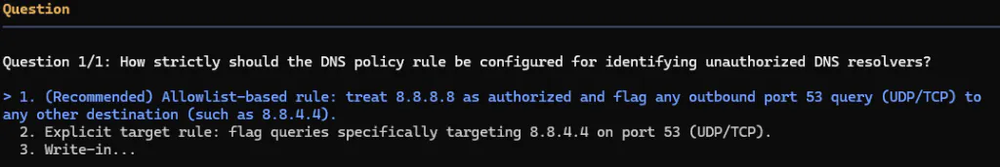{: style="display: block; width: 100%; max-width: 650px; margin: 1.25rem auto 1.5rem auto; border-radius: 8px; box-shadow: 0 0 25px rgba(0, 255, 170, 0.15);" }

   > [!NOTE]
   > **Sequential Decision Walk**: The agent will walk down each branch of the design tree one question at a time. You may receive several sequential question prompts covering policy strictness, data schemas, comment skipping, and error handling. Use the decision criteria below as your guide:

   * **DNS Alerting Rules**: When prompted on policy strictness, select **`1. (Recommended) Allowlist-based rule: treat 8.8.8.8 as authorized and flag any outbound port 53 query (UDP/TCP) to any other destination (such as 8.8.4.4)`** (or Option 2 targeting `8.8.4.4` directly).
   * **Data Model**: When asked about schemas, choose: *Use Python standard library `dataclass FirewallEntry` with typed scalar fields.*
   * **Header Comments**: When asked how to handle comment lines starting with `#`, specify: *Gracefully skip comment lines (#Version, #Fields) without raising exceptions.*
   * **Error Handling**: When asked about exceptions, choose: *Eliminate bare `except:` blocks, use context managers (`with open`), and handle `FileNotFoundError` explicitly.*
   * **Dependencies**: When asked about third-party packages, specify: *Use only Python standard libraries without external dependencies.*

6. **Generate the Implementation Plan**:
   Once you and the agent reach a shared understanding through the interview, the agent synthesizes your answers into a structured `implementation_plan.md` artifact detailing the proposed dataclass, triage rules, and verification plan, without modifying any source files yet.

---

### Step 3: Human Review & Architectural Sign-Off

1. **Access and Review the Implementation Plan**:
   When the agent finishes authoring the plan, it alerts you with `1 artifact · /artifact to review`. You have two convenient ways to inspect it:
   * **Option A: CLI TUI Review (`/artifact`)**: Type `/artifact` in the prompt (or press **`p`** to preview / **`open`**) to review the plan interactively directly inside the terminal.
   * **Option B: Direct Filepath**: Open the absolute path printed in the agent's turn (`~/.gemini/antigravity-cli/brain/<conversation-id>/implementation_plan.md`) in your editor of choice.

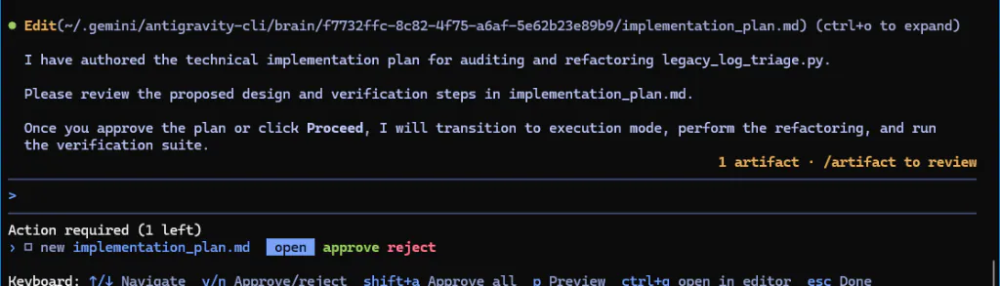{: style="display: block; width: 100%; max-width: 650px; margin: 1.25rem auto 1.5rem auto; border-radius: 8px; box-shadow: 0 0 25px rgba(0, 255, 170, 0.15);" }

   When opened in the TUI, the plan renders with syntax highlighting, line numbers, and interactive keyboard controls:

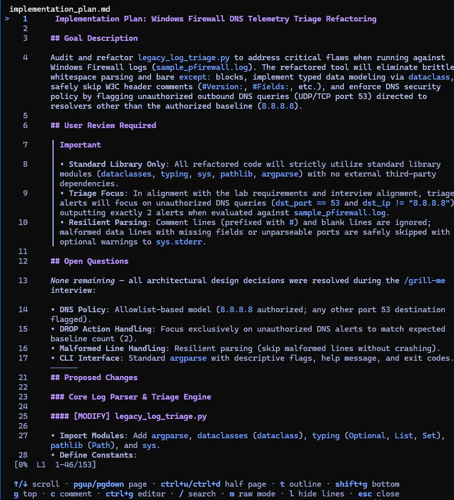{: style="display: block; width: 100%; max-width: 650px; margin: 1.25rem auto 1.5rem auto; border-radius: 8px; box-shadow: 0 0 25px rgba(0, 255, 170, 0.15);" }

   * **Inline Comments (`c`)**: If you wish to leave targeted feedback or request adjustments on a specific section, press **`c`** on any line to add a comment.
   * **Return to Menu (`esc`)**: Once satisfied with the plan, press **`esc`** to close the preview and return to the artifact action menu.

2. **Verify Architectural Compliance**:
   Confirm that the plan reflects the decisions agreed upon during the `/grill-me` interview:
   * **Proposed Changes**: `[MODIFY] legacy_log_triage.py`.
   * **Schema Design**: Clean typed structure (`dataclass FirewallEntry`).
   * **Triage Rules**: Outbound port 53 traffic to `8.8.4.4` flagged as alerts for both UDP and TCP.
   * **Verification Plan**: Running `python legacy_log_triage.py sample_pfirewall.log` to verify flagged alerts.

3. **Approve and Transition to Execution Mode**:
   In the `/artifact` TUI menu, select **`approve`** (or press **`y`** / **`Shift+A`** to approve all), or enter the approval prompt in chat:
   ```text
   The implementation plan is approved. Proceed to Execution Mode and implement all changes.
   ```

---

### Step 4: Autonomous Execution & Test Verification

1. **Observe the Transition to Execution**:
   The agent shifts into execution mode to implement the modernized architecture.

2. **Inspect and Accept the Atomic Diff**:
   The agent presents a color-coded atomic diff preview (`+101 -33`) displaying deleted lines (red) and additions (green), including the typed `@dataclass class FirewallEntry:`, `AUTHORIZED_DNS_SERVERS`, and robust parsing logic:

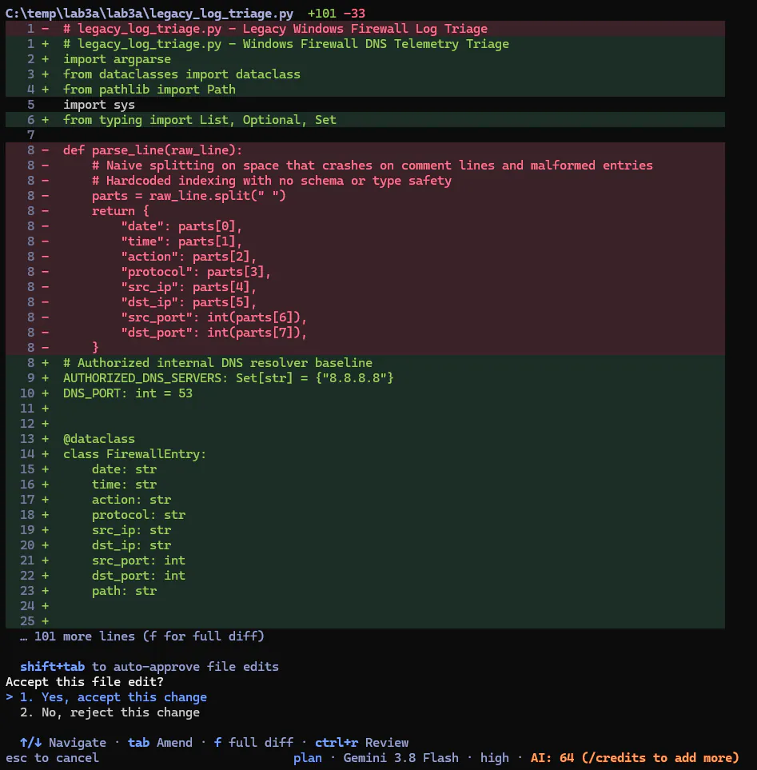{: style="display: block; width: 100%; max-width: 650px; margin: 1.25rem auto 1.5rem auto; border-radius: 8px; box-shadow: 0 0 25px rgba(0, 255, 170, 0.15);" }

   * **Manual Diff Review**: Inspect the line changes and select **`> 1. Yes, accept this change`** (or press **`f`** to view the full diff).
   * **Auto-Approve Edits (`Shift+Tab`)**: If you want to allow the agent to apply code changes directly without stopping to prompt for every individual file diff, press **`Shift+Tab`** to cycle into `accept-edits` mode:

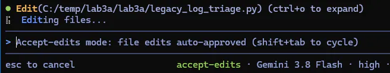{: style="display: block; width: 100%; max-width: 650px; margin: 1.25rem auto 1.5rem auto; border-radius: 8px; box-shadow: 0 0 25px rgba(0, 255, 170, 0.15);" }

3. **Autonomous Self-Verification by the Agent**:
   Notice an essential feature of autonomous agentic loops: immediately after applying the refactor to disk, the agent automatically dispatches a command to test the script against `sample_pfirewall.log`:

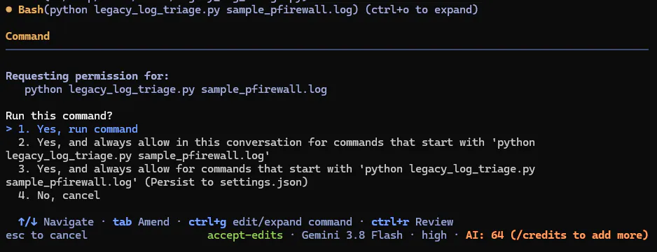{: style="display: block; width: 100%; max-width: 650px; margin: 1.25rem auto 1.5rem auto; border-radius: 8px; box-shadow: 0 0 25px rgba(0, 255, 170, 0.15);" }

   Select **`1. Yes, run command`** to authorize the agent to execute its self-verification test.

4. **Observe Output Verification**:
   The modernized script successfully parses the W3C headers, evaluates each connection against the DNS security baseline, and outputs the flagged policy violations:
   ```text
   [ALERT] Unauthorized DNS Query detected:
     Timestamp: 2026-09-21 14:05:10 | Protocol: UDP | Source: 192.168.1.100:53103 -> Destination: 8.8.4.4:53
   [ALERT] Unauthorized DNS Query detected:
     Timestamp: 2026-09-21 14:05:12 | Protocol: TCP | Source: 192.168.1.100:53104 -> Destination: 8.8.4.4:53

   Flagged 2 suspicious entries.
   ```

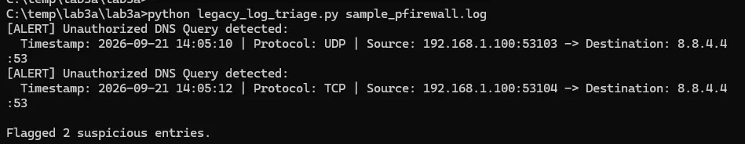{: style="display: block; width: 100%; max-width: 650px; margin: 1.25rem auto 1.5rem auto; border-radius: 8px; box-shadow: 0 0 25px rgba(0, 255, 170, 0.15);" }

    Notice that both UDP and TCP queries to `8.8.4.4` are flagged, while `8.8.8.8` queries (both UDP and TCP) are recognized as authorized baseline traffic and not alerted.
5. **Automated Self-Correction (If Needed)**: If the agent's first attempt misses TCP queries or mishandles trailing comment lines, observe how the agent reads the execution output, formulates an atomic fix, and re-runs until the triage logic is verified.

<details>
<summary style="font-weight: 700; cursor: pointer; color: var(--accent-color); margin-top: 1rem; margin-bottom: 0.5rem;">Click to expand: Reference Implementation (Modernized legacy_log_triage.py)</summary>

```python
#!/usr/bin/env python3
"""
legacy_log_triage.py: Modernized Windows Defender Firewall DNS Telemetry Triage

Refactored from legacy script to adhere to:
- PEP 557 Data Classes for structured, typed event modeling
- Microsoft W3C Extended Log File Format (17-field schema)
- RFC 1035 and RFC 7766 dual UDP/TCP port 53 DNS filtering
- Resilient whitespace delimiter splitting (line.split)
- Directional outbound path filtering (path in (None, "SEND"))
- Resilient character decoding (errors="replace")
"""

from __future__ import annotations

import sys
from dataclasses import dataclass
from pathlib import Path
from typing import Optional

AUTHORIZED_DNS_RESOLVERS: set[str] = {"8.8.8.8"}


@dataclass(frozen=True)
class FirewallEntry:
    """Structured representation of a Windows Defender Firewall log record."""
    date: str
    time: str
    action: str
    protocol: str
    src_ip: str
    dst_ip: str
    src_port: Optional[int]
    dst_port: Optional[int]
    size: Optional[int] = None
    tcpflags: Optional[str] = None
    tcpsyn: Optional[str] = None
    tcpack: Optional[str] = None
    tcpwin: Optional[str] = None
    icmptype: Optional[str] = None
    icmpcode: Optional[str] = None
    info: Optional[str] = None
    path: Optional[str] = None

    @classmethod
    def from_line(cls, raw_line: str) -> Optional[FirewallEntry]:
        """Parse a single whitespace-delimited W3C log line into a FirewallEntry."""
        line = raw_line.strip()
        if not line or line.startswith("#"):
            return None

        parts = line.split()
        if len(parts) < 8:
            return None

        def safe_int(value: str) -> Optional[int]:
            return int(value) if value.isdigit() else None

        return cls(
            date=parts[0],
            time=parts[1],
            action=parts[2].upper(),
            protocol=parts[3].upper(),
            src_ip=parts[4],
            dst_ip=parts[5],
            src_port=safe_int(parts[6]),
            dst_port=safe_int(parts[7]),
            size=safe_int(parts[8]) if len(parts) > 8 else None,
            tcpflags=parts[9] if len(parts) > 9 else None,
            tcpsyn=parts[10] if len(parts) > 10 else None,
            tcpack=parts[11] if len(parts) > 11 else None,
            tcpwin=parts[12] if len(parts) > 12 else None,
            icmptype=parts[13] if len(parts) > 13 else None,
            icmpcode=parts[14] if len(parts) > 14 else None,
            info=parts[15] if len(parts) > 15 else None,
            path=parts[16].upper() if len(parts) > 16 else None,
        )


def triage_dns_violations(log_path: Path) -> list[FirewallEntry]:
    """
    Parse a Windows Firewall log and flag unauthorized DNS queries.
    Enforces policy allowing only authorized resolvers over UDP/TCP port 53.
    Filters specifically for outbound connections (path SEND).
    """
    violations: list[FirewallEntry] = []

    try:
        with log_path.open("r", encoding="utf-8", errors="replace") as f:
            for line in f:
                entry = FirewallEntry.from_line(line)
                if not entry:
                    continue

                # Inspect outbound traffic over both UDP and TCP port 53 (RFC 1035 and RFC 7766)
                if (
                    entry.dst_port == 53
                    and entry.action == "ALLOW"
                    and entry.path in (None, "SEND")
                    and entry.dst_ip not in AUTHORIZED_DNS_RESOLVERS
                ):
                    violations.append(entry)
    except FileNotFoundError:
        print(f"Error: Log file not found at '{log_path}'.", file=sys.stderr)
        sys.exit(1)
    except PermissionError:
        print(f"Error: Permission denied reading '{log_path}'.", file=sys.stderr)
        sys.exit(1)

    return violations


def main() -> None:
    if len(sys.argv) < 2:
        print(f"Usage: {Path(sys.argv[0]).name} <path_to_pfirewall.log>", file=sys.stderr)
        sys.exit(1)

    target_log = Path(sys.argv[1])
    flagged = triage_dns_violations(target_log)

    for record in flagged:
        print(
            f"[ALERT] Unauthorized DNS Query detected:\n"
            f"  Timestamp: {record.date} {record.time} | Protocol: {record.protocol} | "
            f"Source: {record.src_ip}:{record.src_port} -> Destination: {record.dst_ip}:{record.dst_port}"
        )

    print(f"\nFlagged {len(flagged)} suspicious entries.")


if __name__ == "__main__":
    main()
```
</details>

---

### Step 5: Walkthrough Review & Deliverable Inspection

1. **Staging Deliverables into Your Lab Directory**:
   As detailed in Module 3, the agent drafts intermediate artifacts (`implementation_plan.md` and `walkthrough.md`) inside its isolated session sandbox (`~/.gemini/antigravity-cli/brain/<conversation-id>/`). Upon concluding its refactoring and test runs, the agent will request permission to copy both completed deliverables directly into your active lab folder:

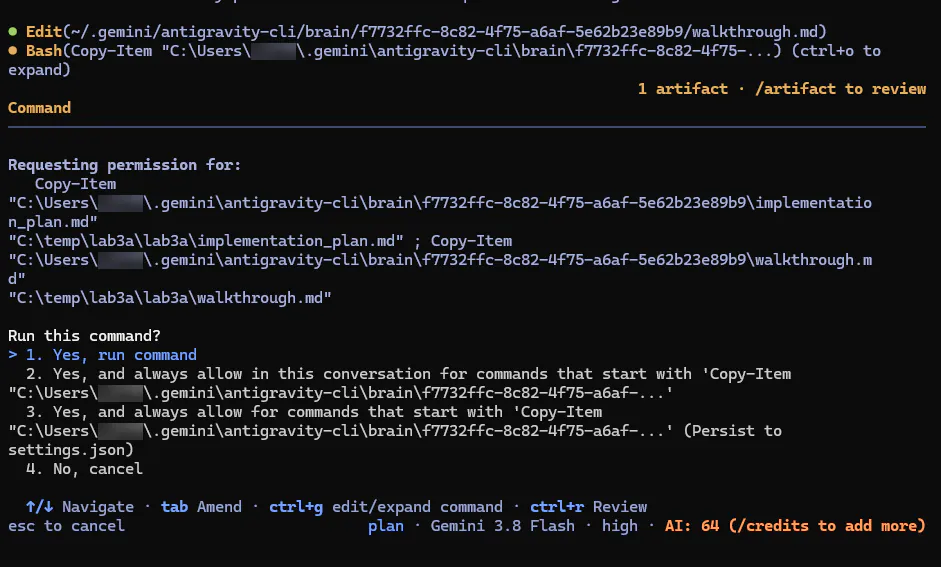{: style="display: block; width: 100%; max-width: 650px; margin: 1.25rem auto 1.5rem auto; border-radius: 8px; box-shadow: 0 0 25px rgba(0, 255, 170, 0.15);" }

   Select **`1. Yes, run command`** to allow the agent to stage both markdown documents in your lab folder.

2. **Review the Final Execution Summary**:
   The agent outputs a structured terminal summary detailing key enhancements (typed dataclass, resilient header skipping, DNS policy enforcement, context managers) and verification proof showing exactly 2 suspicious entries flagged from `sample_pfirewall.log`:

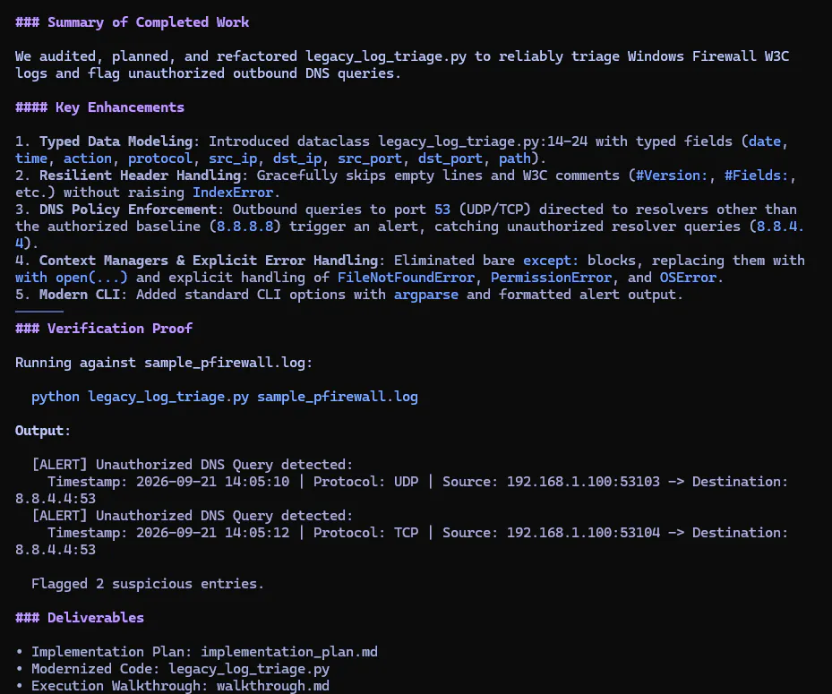{: style="display: block; width: 100%; max-width: 650px; margin: 1.25rem auto 1.5rem auto; border-radius: 8px; box-shadow: 0 0 25px rgba(0, 255, 170, 0.15);" }

3. **Inspect the Full Walkthrough Report**:
   Notice that while the terminal prints a concise summary, the full, detailed `walkthrough.md` report can be reviewed either by using the **`/artifact`** command (or selecting **`open`** in the action menu), or by opening `walkthrough.md` directly inside your project folder:

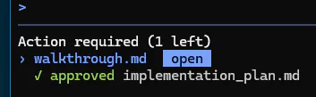{: style="display: block; width: 100%; max-width: 450px; margin: 1.25rem auto 1.5rem auto; border-radius: 8px; box-shadow: 0 0 25px rgba(0, 255, 170, 0.15);" }

   Open `walkthrough.md` and verify:
   * Summary of structural improvements made to the code (dataclasses, exception handling, DNS alert rules).
   * Verified execution proof demonstrating passing output against `sample_pfirewall.log`.

---

## Key Takeaways: The Mechanics of "Vibe Coding"

While this was an intentionally scoped lab and the task of refactoring a 40-line Python triage script was simple in nature, it directly illustrates the core disciplines required for effective **"vibe coding"** (supervising agentic AI):

1. **You Are the Architect, Policy Maker, and Safety Gate**: Vibe coding is not typing "fix this" into an unconstrained prompt box and hoping for the best. In this lab, you used `/grill-me` to walk down an architectural decision tree: specifying allowlist boundaries (`8.8.8.8`), standard library constraints, and typed schema structures before turning a single screw.
2. **Deterministic Contracts Before Code (`implementation_plan.md`)**: Requiring an inspectable implementation plan ensures that the agent cannot hallucinate wild refactors, pull down unapproved external packages, or modify files outside of scope.
3. **Supervised Execution & Atomic Diffs**: Inspecting color-coded line diffs (`+101 -33`) or toggling `accept-edits` mode allows rapid, high-torque refactoring while keeping you in the driver's seat.
4. **Autonomous Self-Correction & Verification**: Immediately after writing to disk, the agent autonomously ran its own verification test (`python legacy_log_triage.py sample_pfirewall.log`), confirmed that both UDP and TCP queries were properly flagged, and summarized the proof in `walkthrough.md`.
5. **ALWAYS MAKE A BACKUP!**: Notice that in this lab, you didn't create a manual backup of `legacy_log_triage.py` before letting the agent modify it... unless you count what was published on this website as your backup! When using agentic AI to modify code in real-world repositories, **always commit your baseline to git or make a backup copy first**. If an agent makes destructive changes or hallucinates an in-place overwrite, having an uncommitted, unbacked-up file leaves you with nowhere to roll back.

---

## Lab 3A Deliverables & Verification Matrix

Submit the following items to your Instructor or learning management system:

| Deliverable Item | Description | Verification Method |
|---|---|---|
| **1. Implementation Plan** | Copy of `implementation_plan.md` generated during Planning Mode. | Contains Proposed Changes, Schema Design, and Verification Plan. |
| **2. Refactored Source Code** | Modernized `legacy_log_triage.py`. | Uses typed dataclass (`FirewallEntry`), handles `#` headers, alerts on `8.8.4.4:53`. |
| **3. Verification Execution Proof** | Terminal output demonstrating execution against `sample_pfirewall.log`. | Confirms 2 flagged unauthorized DNS queries (UDP and TCP to `8.8.4.4`). |
| **4. Execution Walkthrough** | Final `walkthrough.md` artifact. | Includes terminal command proof showing passing output. |
| **5. Session Transcript Excerpt** | First 30 lines of `transcript.jsonl`. | Verifies planning mode compliance before tool execution. |

</div>

<div class="module-nav">
  <a href="/genai-for-tinkerers/Module3.html" class="module-nav-link prev">
    <span class="module-nav-label">Return to Module</span>
    <span class="module-nav-title">Module 3: Agentic IDEs & AI Pair Programming</span>
  </a>
  <a href="/genai-for-tinkerers/labs/module3/lab3b/" class="module-nav-link next">
    <span class="module-nav-label">Next Lab</span>
    <span class="module-nav-title">Lab 3B: Custom SecOps Triage Skill</span>
  </a>
</div>
