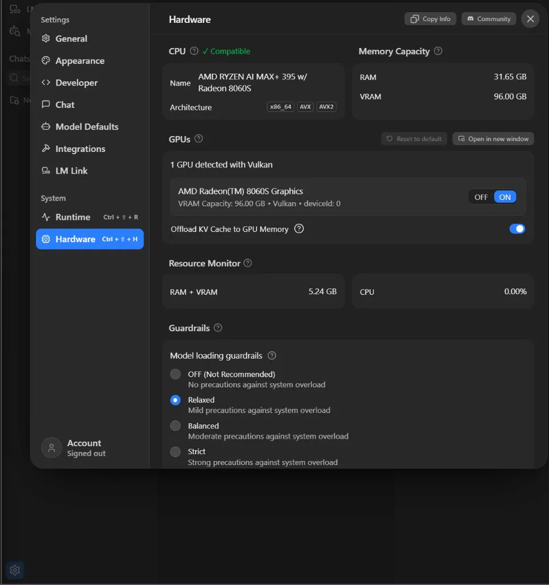
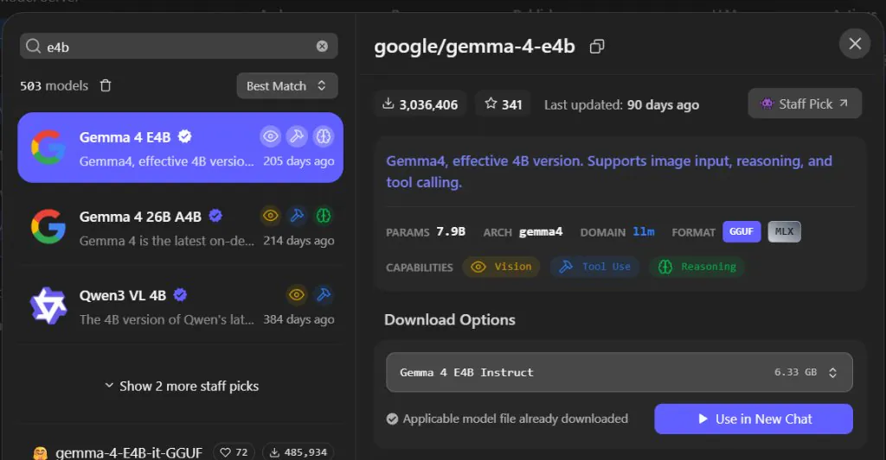
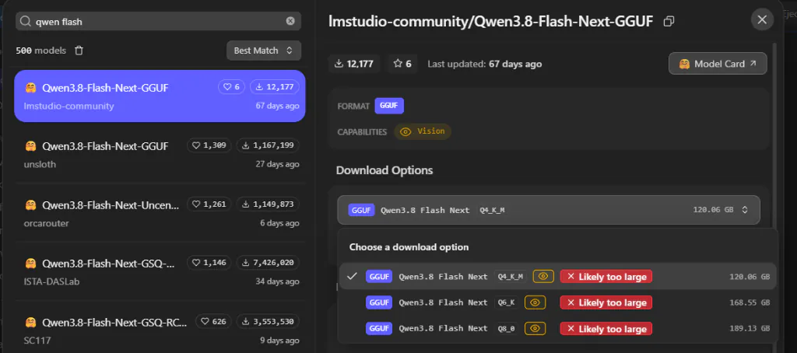
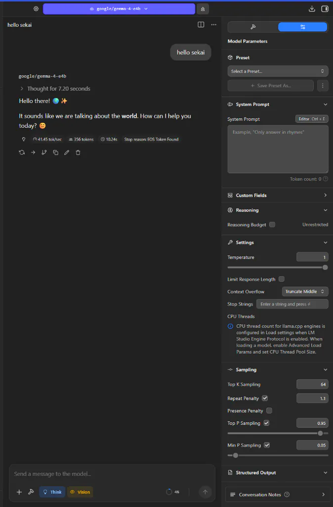
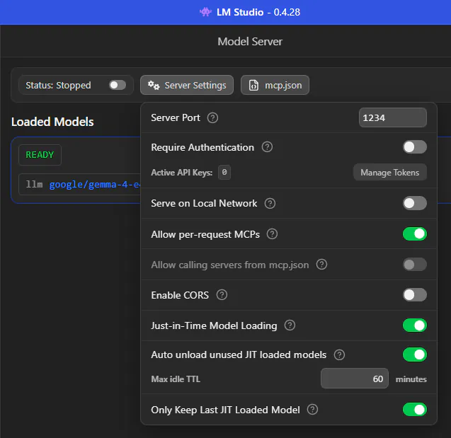
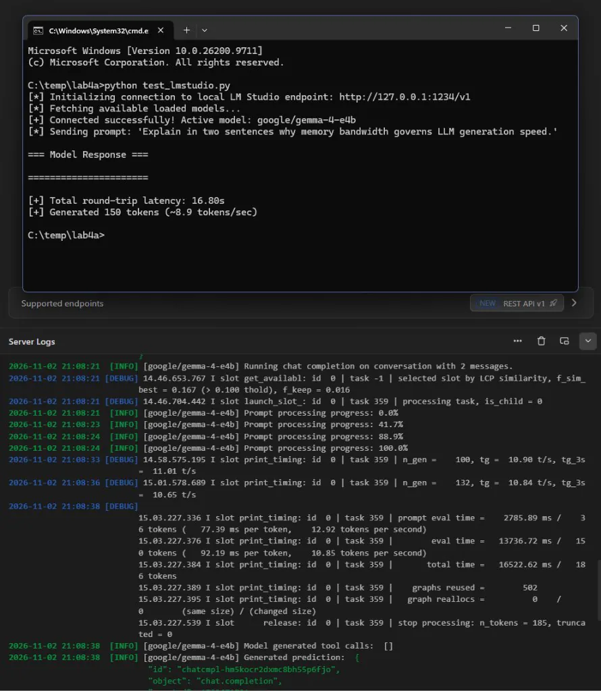

<div class="content-header">Lab 4A: The Dyno Bench: LM Studio Visual Sizing, Guardrails & Local Server</div>

<div class="breadcrumbs">
  <a href="/">Home</a>
  <span class="separator">/</span>
  <a href="/genai-for-tinkerers/">GenAI for Tinkerers</a>
  <span class="separator">/</span>
  <a href="/genai-for-tinkerers/Module4.html">Module 4</a>
  <span class="separator">/</span>
  <span class="current">Lab 4A</span>
</div>

<div class="card" markdown="1">

# Lab 4A: The Dyno Bench: LM Studio Visual Sizing, Guardrails & Local Server

**Module:** [Module 4: Local Open-Weight Inference & Hardware Architecture](/genai-for-tinkerers/Module4.html)  
**Target Environment:** Windows, macOS, or Linux (Desktop, Laptop, or VM)  
**Estimated Completion Time:** 35 Minutes  

* TOC
{:toc}

---

## Lab Objectives

1. **Install LM Studio**: Deploy the LM Studio desktop environment across Windows, macOS, or Linux.
2. **Profile Hardware Telemetry**: Inspect how the runtime discovers your physical GPU, dedicated VRAM, system RAM, and CPU vector extensions.
3. **Navigate Visual Guardrails**: Search the open-weight model catalog and interpret color-coded memory fit indicators (full GPU offload, partial offload, and out-of-memory warnings) before committing to a download.
4. **Calibrate Dyno Parameters**: Load a model into the Chat Playground and calibrate reasoning toggles, context overflow behavior, sampling controls, and generation temperature.
5. **Launch the Local OpenAI-Compatible REST Server**: Start the embedded HTTP server bound to `http://127.0.0.1:1234/v1`.
6. **Execute Dual-Track Verification**: Test endpoint health and prompt completion using terminal CLI commands (`curl` / PowerShell `Invoke-RestMethod`) and run a clean Python client verification script (`test_lmstudio.py`).

---

## Scenario Overview

Before an Automotive Fabricator drops a newly acquired engine into a vehicle chassis, they bolt the powerplant to a stationary dynamometer (dyno) bench. The dyno bench provides a controlled environment with physical gauges, oil pressure readouts, and temperature sensors. If the fuel-air mixture is too lean or the cooling lines are pinched, you discover the problem safely on the test stand rather than out on the highway.

In this lab, you assume the role of an AI Systems Engineer configuring your local hardware as a private inference runtime. Rather than setting up a heavyweight multi-container web platform like BionicGPT, you will use [LM Studio](https://lmstudio.ai/) directly as your personal desktop dyno bench. You will inspect your hardware capacity, download open-weight model weights tailored to your available memory, adjust runtime parameters, spin up an OpenAI-compatible REST server, and confirm that external applications can query your local silicon over HTTP.

---

> [!NOTE]
> **No Gatekeeping on Hardware**
>
> You do not need a high-end gaming PC or a four-thousand-dollar workstation to complete this lab. If you have an Apple Silicon MacBook, an AMD APU, or a budget office laptop running an integrated CPU, you can run compact 2B to 4B models (such as `gemma4:e4b`, `gemma4:e2b`, or `qwen3:4b`). LM Studio will visually indicate what your hardware can comfortably handle.

---

## Part 1: Installing LM Studio & Hardware Detection

### Step 1: Download & Install
1. Open your web browser and navigate to the official [LM Studio download portal](https://lmstudio.ai/download).
2. Download the installer matching your operating system:
   * **Windows**: Executable installer (`.exe`) with native acceleration via the [Nvidia CUDA Toolkit](https://developer.nvidia.com/cuda-toolkit), [AMD ROCm compute stack](https://rocm.docs.amd.com/), or CPU vector instructions.
   * **macOS**: Apple Silicon installer (`.dmg`) leveraging the hardware-accelerated [Apple Metal framework](https://developer.apple.com/metal/) for zero-copy unified memory access.
   * **Linux**: AppImage package supporting ROCm, CUDA, and CPU fallback.
3. Run the installer and launch **LM Studio**.

```text
+------------------------------------------------------------------------+
|                      LM STUDIO ARCHITECTURE OVERVIEW                   |
|                                                                        |
|   +----------------------------------------------------------------+   |
|   |   User Interface (Model Search, Chat Playground, Server Tab)   |   |
|   +----------------------------------------------------------------+   |
|                                   |                                    |
|   +----------------------------------------------------------------+   |
|   |   llama.cpp High-Performance C/C++ Inference Backend           |   |
|   +----------------------------------------------------------------+   |
|                                   |                                    |
|   +----------------------------------------------------------------+   |
|   |   Hardware Layer: CUDA (Nvidia), Metal (Apple), ROCm (AMD),    |   |
|   |   or AVX-512 / AVX2 CPU Vector Instructions                    |   |
|   +----------------------------------------------------------------+   |
+------------------------------------------------------------------------+
```

Underneath the graphical interface, LM Studio executes tensor calculations using Georgi Gerganov's bare-metal [llama.cpp inference engine](https://github.com/ggerganov/llama.cpp), written in plain C and C++ to eliminate Python interpreter overhead while dispatching operations directly to host silicon.

### Step 2: Inspect Hardware Telemetry (Settings Gear -> System -> Hardware)
Upon opening LM Studio, open the **Settings Gear** (`⚙️`) in the lower-left corner and navigate to **System -> Hardware** (or press `Ctrl + Shift + H` / `Cmd + Shift + H`):

{: style="display: block; width: 100%; max-width: 650px; margin: 1.25rem auto 1.5rem auto; border-radius: 8px; box-shadow: 0 0 25px rgba(0, 255, 170, 0.15);" }

1. Inspect the **CPU** and **GPUs** panels: note your processor architecture (`x86_64`, `AVX`, `AVX2`), detected GPU device name (for example, `AMD Radeon(TM) 8060S Graphics` on an AMD Ryzen AI Max+ 395 / Strix Halo platform, an Nvidia RTX card, or Apple Silicon), active backend (`Vulkan`, `CUDA`, `ROCm`, or `Metal`), and **VRAM Capacity**.
2. Inspect the **Memory Capacity** and **Resource Monitor** panels: note your split or unified **RAM** and **VRAM** pools, along with the **Offload KV Cache to GPU Memory** toggle and **Model loading guardrails** (`OFF`, `Relaxed`, `Balanced`, or `Strict`).
3. If running on a system without a dedicated GPU, observe that LM Studio defaults to CPU acceleration using vector extensions (such as AVX2 or ARM NEON).
4. Pay close attention to your **baseline memory overhead** in the Resource Monitor (`RAM + VRAM` already sitting at several gigabytes) before loading any weights. On a workstation, your operating system already reserves a noticeable slice of memory just to drive the desktop environment: rendering multiple high-resolution 4K monitors, running animated motion wallpapers (such as Wallpaper Engine), and keeping dozens of hardware-accelerated web browser or Electron tabs open can quietly eat 1.5GB to 5GB+ of baseline memory before your inference runtime even starts.
5. Note how **Unified Memory Architectures** behave compared to discrete PCIe graphics cards. Platforms such as the AMD Ryzen AI Max+ 395 / Strix Halo shown above (which can allocate 96GB of VRAM alongside 32GB of system RAM from a 128GB unified pool across a 256-bit memory bus delivering roughly 256 GB/s of bandwidth), the Nvidia DGX Spark, and Apple Silicon allow you to fit large multi-billion-parameter weights (`gemma4:26b` MoE or `qwen3.8:27b`) in memory without PCIe bus bottlenecks, though their raw per-token decode throughput remains governed by that shared 256-bit bus rather than the 500 to 1,000+ GB/s GDDR6X/GDDR7 buses found on high-wattage discrete GPUs.

---

## Part 2: Model Discovery & Visual Hardware Guardrails

### Step 1: Searching for a Model (or Selecting Your Onboarding Model)
1. Click the **Search** magnifying glass icon in the left-hand navigation rail (or press `Ctrl + M` / `Cmd + M`).
2. **Note on First-Launch Onboarding**: When you launch LM Studio for the first time, the onboarding wizard may have already prompted you to download a recommended starter model such as **`google/gemma-4-e4b`** (or another lightweight model matched to your hardware). If you already downloaded `gemma-4-e4b` during setup, you will see **"Applicable model file already downloaded"** and a purple **Use in New Chat** button right in the model card!
3. Otherwise, in the search bar, type `e4b`, `gemma-4`, `qwen 3.8`, or `qwen flash` to explore current 2026 open-weight releases alongside proven classics from Google DeepMind's [Gemma 4 family](https://ai.google.dev/gemma) (`Gemma 4 E4B`, `Gemma 4 E2B`, `Gemma 4 12B`, or the sparse `Gemma 4 26B A4B` Mixture-of-Experts model) and Alibaba Cloud's Qwen3 / Qwen3.8 and [Qwen3-Coder family](https://github.com/QwenLM/Qwen3-Coder) (`Qwen3 VL 4B`, `Qwen3.8-27B`, `Qwen3.8-Flash-Next`, `Qwen3-Coder-Next`, or `Qwen2.5-Coder-7B`).

{: style="display: block; width: 100%; max-width: 650px; margin: 1.25rem auto 1.5rem auto; border-radius: 8px; box-shadow: 0 0 25px rgba(0, 255, 170, 0.15);" }

Notice the capability badges displayed directly on the `Gemma 4 E4B` (`google/gemma-4-e4b`) and `Gemma 4 26B A4B` model cards: **Vision** (eye icon for image input), **Tool Use** (hammer icon for function calling), and **Reasoning** (brain icon for step-by-step thinking chains). *(You will also notice `PARAMS 7.9B` alongside `"effective 4B version"` on the `Gemma 4 E4B` card: the `"E4B"` designation stands for Effective 4B, where multimodal vision/audio encoders and per-layer embeddings bring total stored parameters to ~7.9B while keeping active per-token compute down at the 4B tier.)*

### Step 2: Interpreting Quantization & Memory Fit Guardrails
When you expand the **Download Options** dropdown on any model card, LM Studio evaluates each GGUF quantization file (`Q4_K_M`, `Q6_K`, `Q8_0`) against your detected hardware and active guardrail threshold:
* **Standard 4-Bit Quantization (`Q4_K_M`)**: Delivers roughly 98% of full-precision reasoning with a 70% reduction in memory footprint, as detailed in [Hugging Face's guide to GGUF quantization](https://huggingface.co/docs/hub/gguf). Compact models like `Gemma 4 E4B` (`~6.33 GB` including multimodal projection weights) fit comfortably inside 8GB+ GPUs and unified memory laptops with full GPU offload.
* **Testing the Guardrail Limits ("Likely too large")**: To see LM Studio's hardware protection guardrails in action, search for a massive frontier-scale Mixture-of-Experts repository such as **`lmstudio-community/Qwen3.8-Flash-Next-GGUF`** and open its quantization dropdown:

{: style="display: block; width: 100%; max-width: 650px; margin: 1.25rem auto 1.5rem auto; border-radius: 8px; box-shadow: 0 0 25px rgba(0, 255, 170, 0.15);" }

Observe how even on a workstation with a 96GB VRAM allocation, the `Qwen3.8-Flash-Next` quantizations (`120.06 GB` in `Q4_K_M`, `168.55 GB` in `Q6_K`, and `189.13 GB` in `Q8_0`) exceed the available GPU memory envelope and are flagged with a bright red **`✕ Likely too large`** badge! This visual guardrail prevents you from accidentally pulling and loading a model that would immediately thrash your swap file or lock up your operating system.

### Step 3: Downloading Your Model
1. Select a model that fits comfortably within your machine's memory budget (for our standard walkthrough, we use **`google/gemma-4-e4b`**):
   * **For 4GB-8GB VRAM or CPU-only laptops**: Use a 2B to 4B model (such as `Gemma 4 E4B`, `Gemma 4 E2B`, or `Qwen3 VL 4B`).
   * **For 12GB-16GB VRAM**: Use a 7B to 12B model (such as `Qwen2.5-Coder-7B` or `Gemma 4 12B`).
   * **For 24GB+ VRAM or 64GB-128GB Unified Memory (Strix Halo / DGX Spark / Apple Silicon)**: Test a larger reasoning or Mixture-of-Experts model (such as `Gemma 4 26B A4B` or `Qwen3.8-27B`).
2. If you have not already downloaded `google/gemma-4-e4b` during first-launch setup, click **Download** and wait for the weights, packaged using the binary [GGUF specification](https://github.com/ggml-org/ggml/blob/master/docs/gguf.md) maintained by the ggml and llama.cpp projects, to finish saving to disk.

---

## Part 3: Calibrating Dyno Parameters in the Chat Playground

### Step 1: Loading the Model & Inspecting Model Parameters
1. Click **Use in New Chat** from the model card (or click the **Chat** icon in the left navigation menu and select **`google/gemma-4-e4b`** from the top model selector bar).
2. Open the right-hand **Model Parameters** configuration panel (the sliders icon in the top-right corner) to inspect your active tuning controls:

{: style="display: block; width: 100%; max-width: 550px; margin: 1.25rem auto 1.5rem auto; border-radius: 8px; box-shadow: 0 0 25px rgba(0, 255, 170, 0.15);" }

### Step 2: Calibrating Context, Reasoning & Sampling Controls
Review the controls in the right-hand **Model Parameters** panel and bottom prompt bar:
1. **System Prompt & Reasoning Budget**: Notice that `google/gemma-4-e4b` includes native **Think** (bulb icon) and **Vision** (eye icon) toggles directly in the prompt bar, along with a **Reasoning** section in the right-hand panel. When **Think** is active, the model executes an internal chain-of-thought pass (`Thought for 7.20 seconds`) before emitting its final response.
2. **Settings (Temperature & Context Overflow)**:
   * **Temperature**: Controls token randomness. While the UI defaults to `1` (or `0.7`-`1.0` for creative chat), try dialing it down to `0.2` when performing deterministic code generation or log analysis.
   * **Context Overflow**: Defaults to `Truncate Middle`, preserving your initial system instructions and your most recent turns if a conversation exceeds the allocated context window (note the circular context usage gauge at the bottom of the chat box showing `4%` consumed).
3. **Sampling (`Top K`, `Repeat Penalty`, `Top P`, `Min P`)**: Leave **Top P Sampling** at `0.95` (activating [Ari Holtzman and colleagues' Nucleus Sampling technique](https://arxiv.org/abs/1904.09751)) and **Min P Sampling** at `0.05` to prune low-probability noise from the generation tail.

### Step 3: Running a Test Inference & Inspecting Telemetry
In the chat prompt box, send a quick greeting (such as `hello sekai`) or a technical diagnostic prompt:
```text
Write a concise Python function that takes a list of IP addresses and returns only valid IPv4 addresses.
```
Observe the telemetry pills rendered directly underneath the model's response:
* **Generation Speed**: `41.45 tok/sec`
* **Total Tokens Generated**: `356 tokens`
* **Total Elapsed Time**: `10.24s`
* **Stop Reason**: `EOS Token Found`

---

## Part 4: Starting the Local OpenAI-Compatible REST Server

Now that your model is loaded and tuned on the dyno bench, it is time to open the local REST endpoint so external scripts and tools can communicate with it.

### Step 1: Configure & Start the Model Server
1. Navigate to the **Developer / Model Server** view (via the `<->` Developer tab in the navigation rail) and click the **`⚙️ Server Settings`** button next to the server status toggle:

   {: style="display: block; width: 100%; max-width: 550px; margin: 1.25rem auto 1.5rem auto; border-radius: 8px; box-shadow: 0 0 25px rgba(0, 255, 170, 0.15);" }

2. Confirm that your model (`llm google/gemma-4-e4b`) is listed under **Loaded Models** with a green **`READY`** badge. As outlined in [LM Studio's OpenAI API compatibility guide](https://lmstudio.ai/docs/developer/openai-compat), activating the local server exposes an HTTP service that adheres to the standard OpenAI `/v1/chat/completions` and `/v1/models` schemas.
3. Review the **Server Settings** dropdown controls:
   * **Server Port**: Default is `1234`.
   * **Require Authentication**: Optional token gate (off by default for localhost).
   * **Serve on Local Network**: Keep **OFF** (unchecked) so the server binds strictly to loopback (`127.0.0.1`) rather than `0.0.0.0`.
   * **Allow per-request MCPs / `mcp.json`**: Notice that LM Studio 0.4+ natively integrates Model Context Protocol (MCP) tool controls right alongside the server configuration!
   * **Enable CORS**: Toggle on if connecting browser-based apps, or leave default for CLI and Python SDK scripts.
   * **Just-in-Time (JIT) Model Loading & Auto Unload**: Automatically loads requested models on demand and unloads idle models after the configured TTL (`60 minutes`).
4. Flip the top-left server toggle from **`Status: Stopped`** to **Running** to start listening on `http://127.0.0.1:1234/v1`.

> [!TIP]
> **Field Notes from the Server Room Floor**
>
> * **Localhost Binding is a Security Perimeter**: Never check "Serve on Local Network" (`0.0.0.0`) unless you are operating inside an isolated, trusted lab VLAN or binding specifically to a secure Software-Defined Networking (SDN) overlay interface such as **ZeroTier** or **Tailscale** (or fronting the service with an authenticated **Cloudflare Tunnel**). Leaving an unauthenticated model server listening on `0.0.0.0` exposes your local GPU, VRAM, and prompt context to any device on the local network (such as coffee shop or campus Wi-Fi).
> * **Watch for VRAM Spillover and Desktop Overhead**: If you observe token generation speed suddenly crater from 60 tokens/sec down to 12 tokens/sec, inspect your layer offload slider and your background desktop footprint. Driving multiple high-resolution displays, running animated wallpapers like Wallpaper Engine, or keeping hardware-accelerated browser tabs open steals precious VRAM headroom; if even a single transformer layer spills over into system RAM over the PCIe bus, execution becomes bounded by system memory bandwidth rather than GPU VRAM bus speed.

---

## Part 5: Dual-Track API Smoke Testing

With the local REST server running, we verify connectivity using both a raw command-line request and an automated Python client script querying the standard [OpenAI Chat Completions API specification](https://developers.openai.com/api/reference/resources/chat).

### Track 1: Terminal Command Line Verification

Open a new terminal window on your machine and execute a test request.

#### Option A: Windows PowerShell (`Invoke-RestMethod`)
On Windows workstations, dispatch the query using [PowerShell's `Invoke-RestMethod` cmdlet](https://learn.microsoft.com/en-us/powershell/module/microsoft.powershell.utility/invoke-restmethod) to format and parse the JSON payload:
```powershell
$headers = @{
    "Content-Type" = "application/json"
}

$body = @{
    model = "local-model"
    messages = @(
        @{ role = "system"; content = "You are a concise network triage assistant." },
        @{ role = "user"; content = "In one sentence, explain what an ARP broadcast is." }
    )
    temperature = 0.2
} | ConvertTo-Json -Depth 5

$response = Invoke-RestMethod -Uri "http://127.0.0.1:1234/v1/chat/completions" -Method Post -Headers $headers -Body $body
$response.choices[0].message.content
```

Notice that the test prompt asks for an explanation of Address Resolution Protocol broadcast behavior governed by [RFC 826](https://www.rfc-editor.org/rfc/rfc826), providing an immediate check of technical factual recall.

#### Option B: Linux / macOS / Git Bash (`curl`)
In Unix-like environments, dispatch a raw HTTP POST request using [the curl utility](https://curl.se/):
```bash
curl http://127.0.0.1:1234/v1/chat/completions \
  -H "Content-Type: application/json" \
  -d '{
    "model": "local-model",
    "messages": [
      {"role": "system", "content": "You are a concise network triage assistant."},
      {"role": "user", "content": "In one sentence, explain what an ARP broadcast is."}
    ],
    "temperature": 0.2
  }'
```

Verify that the response returns a valid JSON object containing the assistant's generated completion.

### Track 2: Automated Python Client Verification (`test_lmstudio.py`)

Now verify the connection programmatically using the official [OpenAI Python SDK](https://github.com/openai/openai-python).

1. In the lab directory (`genai-for-tinkerers/labs/module4/lab4a/`), install the required dependencies:
   ```bash
   pip install -r requirements.txt
   ```

2. Inspect `test_lmstudio.py`:

```python
"""
test_lmstudio.py
Verifies connectivity and chat completions against a local LM Studio REST server.
Compatible with the standard openai-python SDK.
"""

import sys
import time

try:
    from openai import OpenAI
except ImportError:
    print("[ERROR] The openai library is required. Install via: pip install openai")
    sys.exit(1)


def main():
    # LM Studio default endpoint: http://127.0.0.1:1234/v1
    base_url = "http://127.0.0.1:1234/v1"
    # Local servers do not enforce API keys, but the SDK requires a non-empty string
    api_key = "lm-studio"

    print(f"[*] Initializing connection to local LM Studio endpoint: {base_url}")
    client = OpenAI(base_url=base_url, api_key=api_key)

    try:
        # Step 1: Query loaded models
        print("[*] Fetching available loaded models...")
        models = client.models.list()
        if not models.data:
            print("[WARN] No active model loaded in LM Studio. Please load a model in the UI.")
            return

        active_model = models.data[0].id
        print(f"[+] Connected successfully! Active model: {active_model}")

        # Step 2: Execute test chat completion
        prompt = "Explain in two sentences why memory bandwidth governs LLM generation speed."
        print(f"[*] Sending prompt: '{prompt}'")

        start_time = time.time()
        response = client.chat.completions.create(
            model=active_model,
            messages=[
                {"role": "system", "content": "You are an expert systems engineer."},
                {"role": "user", "content": prompt}
            ],
            temperature=0.2,
            max_tokens=1024
        )
        elapsed = time.time() - start_time

        reply = response.choices[0].message.content or ""
        reasoning = getattr(response.choices[0].message, "reasoning_content", None) or getattr(response.choices[0].message, "reasoning", None) or ""
        tokens = response.usage.completion_tokens if response.usage else 0

        print("\n=== Model Response ===")
        print((reply.strip() or reasoning.strip()))
        print("======================\n")
        print(f"[+] Total round-trip latency: {elapsed:.2f}s")
        if tokens > 0 and elapsed > 0:
            print(f"[+] Generated {tokens} tokens (~{tokens / elapsed:.1f} tokens/sec)")

    except Exception as exc:
        print(f"\n[FAIL] Failed to communicate with LM Studio: {exc}")
        print("[TIP] Ensure LM Studio is open, a model is loaded, and the local server is started on port 1234.")
        sys.exit(1)


if __name__ == "__main__":
    main()
```

{:start="3"}
3. Run the script from your terminal:
   ```bash
   python test_lmstudio.py
   ```

   {: style="display: block; width: 100%; max-width: 650px; margin: 1.25rem auto 1.5rem auto; border-radius: 8px; box-shadow: 0 0 25px rgba(0, 255, 170, 0.15);" }

4. Confirm that the script connects to `http://127.0.0.1:1234/v1`, identifies the active model (`google/gemma-4-e4b`), and reports the round-trip latency and token generation rate.
5. **Inspect the Live Server Logs**: Look at LM Studio's **Server Logs** pane underneath your terminal window. You can watch `llama.cpp` execute the two phases of inference in real time:
   * **Prefill Progress**: `Prompt processing progress: 0.0% -> 41.7% -> 88.9% -> 100.0%` (`prompt eval time = 2785.89 ms / 36 tokens`).
   * **Decode Timing**: `eval time = 13736.72 ms / 150 tokens (10.85 tokens per second)`.
   * **Thinking Budget Lesson (`max_tokens=150` vs. `1024`)**: Notice that in the diagnostic screenshot above (captured during an initial run when `max_tokens` was capped at `150`), `=== Model Response ===` printed empty even though the server generated `150 tokens`! Why? Because `google/gemma-4-e4b` is a reasoning model that emits internal chain-of-thought (`reasoning_content`) tokens before outputting final visible `content` tokens. When `max_tokens` was capped at `150`, the model spent its entire 150-token budget inside its thinking block before reaching the visible answer! That is why our updated `test_lmstudio.py` above sets `max_tokens=1024` and includes a fallback to `reasoning_content` (`reply.strip() or reasoning.strip()`), giving reasoning models enough runway to finish thinking and print their two-sentence summary.

---

## Lab 4A Deliverables & Verification Matrix

Submit the following items to your Instructor or learning management system:

| Deliverable | Artifact / Evidence | Verification Method |
|---|---|---|
| **1. Hardware Fit Telemetry** | Log excerpt or screenshot of detected hardware (GPU, VRAM, RAM) in LM Studio. | Confirms hardware detection and appropriate model selection tier. |
| **2. Chat Playground Dyno Test** | Screenshot or transcript of your Chat Playground test prompt (e.g., Python IPv4 triage function or diagnostic greeting). | Confirms generation temperature and tokens/sec telemetry readout. |
| **3. REST Server Activation Proof** | Terminal output of curl or PowerShell `Invoke-RestMethod` query. | Confirms HTTP 200 response from `http://127.0.0.1:1234/v1/chat/completions`. |
| **4. Automated Client Verification** | Console output from running `python test_lmstudio.py`. | Displays active model ID, completed prompt response, round-trip latency, and tokens/sec. |

<div class="module-nav">
  <a href="/genai-for-tinkerers/Module4.html" class="module-nav-link prev">
    <span class="module-nav-label">Return to Module</span>
    <span class="module-nav-title">← Module 4: Local Open-Weight Inference & Hardware Architecture</span>
  </a>
  <a href="/genai-for-tinkerers/labs/module4/lab4b/" class="module-nav-link next">
    <span class="module-nav-label">Next Lab</span>
    <span class="module-nav-title">Lab 4B: The Service Bay: Ollama CLI Setup & OpenAI-Compatible REST API Scripting →</span>
  </a>
</div>

</div>
