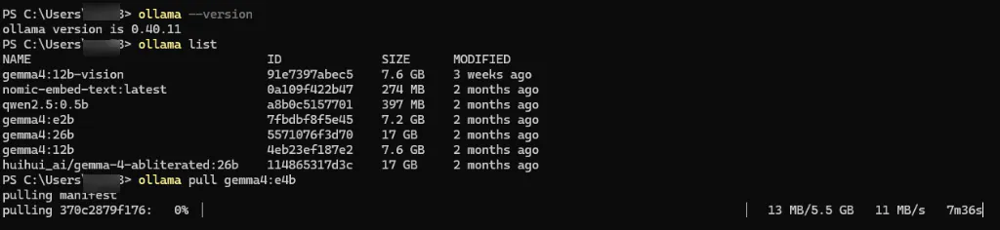
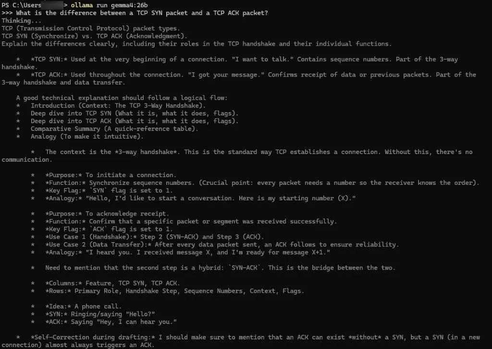
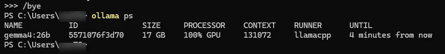
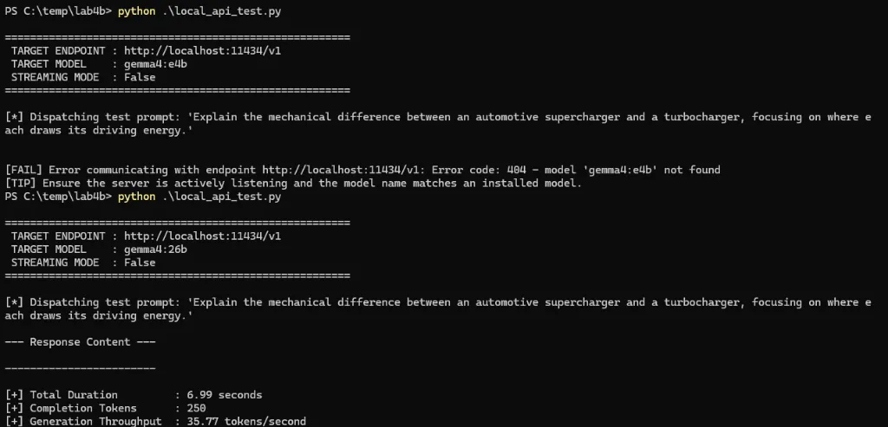
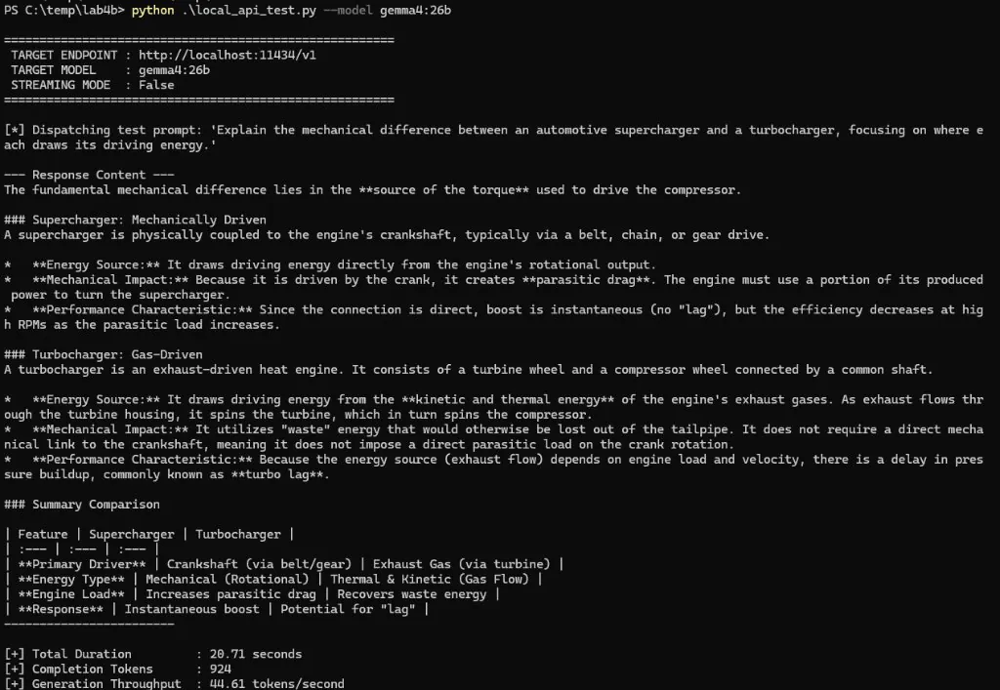

<div class="content-header">Lab 4B: The Service Bay: Ollama CLI Setup & OpenAI-Compatible REST API Scripting</div>

<div class="breadcrumbs">
  <a href="/">Home</a>
  <span class="separator">/</span>
  <a href="/genai-for-tinkerers/">GenAI for Tinkerers</a>
  <span class="separator">/</span>
  <a href="/genai-for-tinkerers/Module4.html">Module 4</a>
  <span class="separator">/</span>
  <span class="current">Lab 4B</span>
</div>

<div class="card" markdown="1">

# Lab 4B: The Service Bay: Ollama CLI Setup & OpenAI-Compatible REST API Scripting

**Module:** [Module 4: Local Open-Weight Inference & Hardware Architecture](/genai-for-tinkerers/Module4.html)  
**Target Environment:** Windows, macOS, or Linux (Command Line / Terminal)  
**Estimated Completion Time:** 40 Minutes  

* TOC
{:toc}

---

## Lab Objectives

1. **Install and Initialize Ollama**: Deploy Ollama as a headless background daemon across Windows, macOS, or Linux.
2. **Master the CLI Model Lifecycle**: Pull, run, inspect, and remove open-weight models directly from the command line interface.
3. **Inspect Process Memory and Offload**: Use `ollama ps` to verify VRAM allocation, processor offload percentages, and active session lifetimes.
4. **Query Native & OpenAI-Compatible Endpoints**: Contrast Ollama's native JSON endpoint (`/api/chat`) with its standard OpenAI-compatible REST endpoint (`/v1/chat/completions`) using command-line HTTP tools.
5. **Develop `local_api_test.py`**: Build a robust Python benchmarking utility that tests endpoint health, supports streaming responses, and measures Time to First Token (TTFT) and generation throughput (tokens/second).
6. **Bridge to Module 5**: Understand how headless local REST endpoints serve as the foundation for custom autonomous agent harnesses.

---

## Scenario Overview

In [Lab 4A](/genai-for-tinkerers/labs/module4/lab4a/), you used LM Studio as an interactive dyno bench: visually sizing models, testing prompt parameters, and observing memory thresholds. While a visual GUI is ideal for exploratory tuning, running a full desktop window is inefficient when you need a resilient, always-on background engine to power scripts, cron jobs, or autonomous agent harnesses.

In this lab, you assume the role of a Systems Administrator and Tinkerer entering the **Service Bay**. You will deploy [Ollama](https://ollama.com/), manage models entirely through terminal commands, inspect background VRAM usage, and write an automated Python benchmarking script (`local_api_test.py`) that measures inference latency and tokens-per-second throughput across any local OpenAI-compatible endpoint. Under the hood, [the open-source Ollama repository](https://github.com/ollama/ollama) orchestrates model weight extraction, layer offloading, and HTTP endpoint binding in Go.

---

> [!NOTE]
> **Personal Reflection: Headless Services & Operational Sovereignty**
>
> When newcomers start tinkering with local models, they naturally gravitate toward desktop GUIs with chat bubbles and sliders. A visual dyno bench is fantastic for initial tuning, but in a 24/7 operations environment, desktop windows are an operational liability. Rendering high-resolution multi-monitor desktops, running animated motion wallpapers like Wallpaper Engine, and keeping hardware-accelerated browser tabs open quietly eat 1.5GB to 3GB of baseline VRAM before your inference runtime even loads a single tensor. Worse yet, GUI apps require interactive desktop logins and cannot be cleanly orchestrated by cron jobs, systemd services, or container daemons.
>
> The transition from a desktop GUI to a headless CLI background service is where you cross the boundary from being a casual user to a true Systems Administrator and Tinkerer. Running Ollama as a headless daemon gives you silent, unmetered intelligence ready to respond to scripts and harnesses without touching a mouse.

---

```text
+------------------------------------------------------------------------+
|                      OLLAMA SERVICE BAY ARCHITECTURE                   |
|                                                                        |
|   +----------------------------------------------------------------+   |
|   |         Automated Python Test Harness / Agent Script           |   |
|   |                   (local_api_test.py)                          |   |
|   +----------------------------------------------------------------+   |
|                                   |                                    |
|              POST /v1/chat/completions (OpenAI Compatible)             |
|              POST /api/chat            (Ollama Native)                 |
|                                   |                                    |
|                                   v                                    |
|   +----------------------------------------------------------------+   |
|   |       Ollama Headless Background Daemon (Port 11434)           |   |
|   |          (Auto-offloading, Model Paging, REST API)             |   |
|   +----------------------------------------------------------------+   |
|                                   |                                    |
|                                   v                                    |
|   +----------------------------------------------------------------+   |
|   |    Local Silicon (Nvidia CUDA / Apple Metal / AMD ROCm / CPU)  |   |
|   +----------------------------------------------------------------+   |
+------------------------------------------------------------------------+
```

---

## Part 1: Installing Ollama & Starting the Background Daemon

### Step 1: Install Ollama
1. Navigate to the official [Ollama download portal](https://ollama.com/download).
2. Download and run the installer for your operating system:
   * **Windows**: Download `OllamaSetup.exe` (or execute `irm https://ollama.com/install.ps1 | iex` in PowerShell). Once installed, Ollama runs quietly in the system tray and starts automatically on login.
   * **macOS**: Download the `.dmg` installer (or run the installation script via curl), move `Ollama.app` to your Applications folder, and launch it.
   * **Linux**: Run [Ollama's official installation script](https://ollama.com/install.sh) in your terminal:
     ```bash
     curl -fsSL https://ollama.com/install.sh | sh
     ```
3. Open a terminal (PowerShell on Windows, Terminal on macOS/Linux) and verify that the CLI binary is available:
   ```bash
   ollama --version
   ```

### Step 2: Verify Daemon Status
By default, the Ollama daemon listens on TCP port `11434`. Verify that the service is running:
* **In PowerShell**:
  ```powershell
  Invoke-RestMethod -Uri "http://localhost:11434/"
  ```
* **In Bash / curl**:
  ```bash
  curl http://localhost:11434/
  ```
Confirm that the response returns the plain text greeting: `Ollama is running`.

---

## Part 2: CLI Model Management & Telemetry

Ollama provides a clean, Docker-like syntax for managing model weights on your local machine.

### Step 1: Pulling a Model
Select a model tailored to your hardware profile, choosing from current 2026 open-weight releases alongside lightweight classics:
* **For 4GB-8GB VRAM or CPU Laptops (Recommended Lab Baseline)**: Pull a compact 2B to 4B model such as Google DeepMind's `gemma4:e4b`, `gemma4:e2b`, Alibaba Cloud's `qwen3:4b`, or [the lightweight Gemma 2 model card in the Ollama library](https://ollama.com/library/gemma2):
  ```bash
  ollama pull gemma4:e4b
  # Or for ultra-minimal hardware: ollama pull gemma4:e2b / ollama pull gemma2:2b
  ```
* **For 12GB-16GB VRAM**: Pull a mid-sized 7B to 12B powerplant such as `gemma4:12b`, `qwen3-coder-next`, or [the Qwen 2.5 Coder card in the Ollama library](https://ollama.com/library/qwen2.5-coder):
  ```bash
  ollama pull qwen2.5-coder:7b
  # Or 2026 releases: ollama pull gemma4:12b / ollama pull qwen3-coder-next
  ```
* **For 24GB+ VRAM or 64GB-128GB Unified Memory (AMD Strix Halo / Nvidia DGX Spark / Apple Silicon)**: Pull a high-capacity dense or Mixture-of-Experts model such as `gemma4:26b` (MoE), `qwen3.8-flash-next`, or `qwen3.8:27b`:
  ```bash
  ollama pull gemma4:26b
  # Or dense 27B: ollama pull qwen3.8:27b
  ```

Observe the progress bar as Ollama streams the quantized GGUF layers directly to your disk cache.

### Step 2: Listing Local Models
Verify the installed models in your local Ollama library (and watch how `ollama pull` streams missing layers):
```bash
ollama list
```

{: style="display: block; width: 100%; max-width: 650px; margin: 1.25rem auto 1.5rem auto; border-radius: 8px; box-shadow: 0 0 25px rgba(0, 255, 170, 0.15);" }

The `ollama list` output displays every model tag currently cached in your local Ollama registry (`gemma4:e2b`, `gemma4:12b`, `gemma4:26b`, embedding models like `nomic-embed-text:latest`, etc.), along with its unique manifest ID, disk size, and modification timestamp. *(Important operational note: Ollama maintains its own model store separate from LM Studio; if you downloaded `gemma-4-e4b` inside LM Studio earlier, Ollama will still need to complete `ollama pull gemma4:e4b` before `gemma4:e4b` appears in `ollama list`!)*

### Step 3: Interactive Terminal Chat
Launch a direct interactive session inside your terminal using `gemma4:e4b` (or an already-cached local model from `ollama list`, such as `gemma4:26b` or `gemma4:e2b`):
```bash
ollama run gemma4:e4b
# Or if gemma4:26b / gemma4:e2b is already in your 'ollama list':
ollama run gemma4:26b
```

At the `>>>` prompt, type a test question:
```text
>>> What is the difference between a TCP SYN packet and a TCP ACK packet?
```

{: style="display: block; width: 100%; max-width: 650px; margin: 1.25rem auto 1.5rem auto; border-radius: 8px; box-shadow: 0 0 25px rgba(0, 255, 170, 0.15);" }

Observe how `gemma4` prints its internal `Thinking...` chain-of-thought outline directly in the terminal before synthesizing the final answer. When finished, exit the session by typing `/bye` or pressing `Ctrl+D`.

### Step 4: Inspecting Process Telemetry with `ollama ps`
When an Ollama model is queried, the daemon keeps the local weights resident in memory for five minutes (by default) to ensure subsequent queries do not incur disk-loading penalties.

Inspect the active memory state right after exiting with `/bye`:
```bash
ollama ps
```

{: style="display: block; width: 100%; max-width: 650px; margin: 1.25rem auto 1.5rem auto; border-radius: 8px; box-shadow: 0 0 25px rgba(0, 255, 170, 0.15);" }

Analyze the returned columns:
* **PROCESSOR (`100% GPU`)**: Indicates the execution target (e.g., `100% GPU`, `85%/15% CPU/GPU`, or `100% CPU`). Remember that if background desktop tasks (4K display compositing, animated wallpapers like Wallpaper Engine, or sprawling browser windows) crowd your discrete GPU VRAM, Ollama will automatically spill excess transformer layers onto system RAM (`CPU/GPU` split). On unified memory architectures like AMD Strix Halo or the Nvidia DGX Spark (128GB unified RAM over a 256-bit bus at roughly 256 to 273 GB/s), `ollama ps` reports unified memory allocation where large models (`gemma4:26b` at `17 GB` with a `131072` context window) run at `100% GPU` on the `llamacpp` runner without PCIe spillover penalties.
* **SIZE / CONTEXT / UNTIL**: Displays how much memory is allocated (`17 GB`), the active context window (`131072` tokens), and the remaining idle countdown (`4 minutes from now`) before the model unloads from RAM/VRAM.

---

## Part 3: Querying Ollama Endpoints via CLI

Ollama exposes two distinct REST interfaces: its native endpoint and its OpenAI-compatible endpoint.

### Track 1: Ollama Native REST API (`/api/chat`)

As documented in [Ollama's native REST API specification](https://github.com/ollama/ollama/blob/main/docs/api.md), querying `/api/chat` returns detailed duration metrics measured in nanoseconds. The native API is streaming-enabled by default. You can test non-streaming execution by setting `"stream": false`:

#### PowerShell:
```powershell
$body = @{
    model = "gemma4:e4b"
    messages = @(
        @{ role = "user"; content = "Summarize the role of a DNS PTR record in one sentence." }
    )
    stream = $false
} | ConvertTo-Json -Depth 5

$res = Invoke-RestMethod -Uri "http://localhost:11434/api/chat" -Method Post -Body $body -ContentType "application/json"
$res.message.content
```

#### Bash / curl:
```bash
curl http://localhost:11434/api/chat \
  -H "Content-Type: application/json" \
  -d '{
    "model": "gemma4:e4b",
    "messages": [
      { "role": "user", "content": "Summarize the role of a DNS PTR record in one sentence." }
    ],
    "stream": false
  }'
```

Observe the detailed metadata returned in the native response, including `total_duration`, `load_duration`, `prompt_eval_count`, and `eval_count` (which you can use to calculate exact tokens per second).

### Track 2: Ollama OpenAI-Compatible Endpoint (`/v1/chat/completions`)

For seamless integration with existing agent harnesses, review [Ollama's OpenAI compatibility guide](https://ollama.com/blog/openai-compatibility). Ollama exposes the universal REST schema at `http://localhost:11434/v1/chat/completions`:

#### PowerShell:
```powershell
$headers = @{ "Content-Type" = "application/json" }
$body = @{
    model = "gemma4:e4b"
    messages = @(
        @{ role = "user"; content = "What does a 403 Forbidden HTTP status code mean?" }
    )
} | ConvertTo-Json -Depth 5

$res = Invoke-RestMethod -Uri "http://localhost:11434/v1/chat/completions" -Method Post -Headers $headers -Body $body
$res.choices[0].message.content
```

#### Bash / curl:
```bash
curl http://localhost:11434/v1/chat/completions \
  -H "Content-Type: application/json" \
  -d '{
    "model": "gemma4:e4b",
    "messages": [
      { "role": "user", "content": "What does a 403 Forbidden HTTP status code mean?" }
    ]
  }'
```

Notice that the response structure matches the standard OpenAI schema identically!

> [!TIP]
> **Field Notes from the Server Room Floor**
>
> * **Guard Your Daemon Binding (`127.0.0.1` vs. `0.0.0.0`)**: By default, Ollama binds strictly to `127.0.0.1:11434`. Never set `OLLAMA_HOST=0.0.0.0:11434` on a mobile workstation or untrusted LAN, as Ollama has no built-in authentication layer and anyone on the subnet can pull models, exhaust your VRAM, or query your active runtime. When connecting remote orchestrators or mobile devices to your headless node, bind specifically to an encrypted Software-Defined Networking (SDN) overlay IP via **ZeroTier** or **Tailscale**, or front the service with an authenticated **Cloudflare Tunnel**.
> * **Beware PowerShell Serialization Limits**: When converting nested request bodies with `ConvertTo-Json`, Windows PowerShell 5.1 enforces a default depth of 2. If your message schema contains nested role dictionaries or function calling payloads, PowerShell will silently serialize inner objects as the string `"System.Collections.Hashtable"`. Always append `-Depth 5` or `-Depth 10` when preparing REST payloads in PowerShell.
> * **The Keepalive Countdown**: Ollama holds unloaded model weights in VRAM for five minutes after the last request (`OLLAMA_KEEP_ALIVE=5m`) before unloading them to reclaim system memory. If you are chaining agentic tasks in scripts, subsequent calls within that five-minute window bypass model load latency entirely.

---

## Part 4: Building the Automated Benchmarking Tool (`local_api_test.py`)

Now we build a production-ready Python benchmarking tool. This script will connect to your local endpoint, test both non-streaming and streaming responses, measure Time to First Token (TTFT), and calculate exact tokens-per-second generation rates.

### Step 1: Install Dependencies
In your terminal, navigate to the lab directory (`genai-for-tinkerers/labs/module4/lab4b/`) and ensure the official [OpenAI Python SDK](https://github.com/openai/openai-python) library is installed:
```bash
pip install -r requirements.txt
```

### Step 2: Code Review: `local_api_test.py`
Inspect the script located in `genai-for-tinkerers/labs/module4/lab4b/local_api_test.py`:

```python
"""
local_api_test.py
Automated latency and throughput benchmarking tool for local OpenAI-compatible endpoints.
Compatible with both Ollama (port 11434) and LM Studio (port 1234).
"""

import argparse
import sys
import time

try:
    from openai import OpenAI
except ImportError:
    print("[ERROR] Missing required library 'openai'. Install via: pip install openai")
    sys.exit(1)


def run_benchmark(base_url: str, model_name: str, stream: bool = False):
    print("\n=======================================================")
    print(f" TARGET ENDPOINT : {base_url}")
    print(f" TARGET MODEL    : {model_name}")
    print(f" STREAMING MODE  : {stream}")
    print("=======================================================\n")

    client = OpenAI(base_url=base_url, api_key="local-tinkerer")

    prompt = (
        "Explain the mechanical difference between an automotive supercharger "
        "and a turbocharger, focusing on where each draws its driving energy."
    )

    print(f"[*] Dispatching test prompt: '{prompt}'\n")

    try:
        if not stream:
            # Non-streaming benchmark
            start_time = time.time()
            response = client.chat.completions.create(
                model=model_name,
                messages=[
                    {"role": "system", "content": "You are a concise Mechanical Engineer."},
                    {"role": "user", "content": prompt}
                ],
                temperature=0.3,
                max_tokens=1024
            )
            total_time = time.time() - start_time

            reply = response.choices[0].message.content or ""
            reasoning = getattr(response.choices[0].message, "reasoning_content", None) or getattr(response.choices[0].message, "reasoning", None) or ""
            completion_tokens = response.usage.completion_tokens if response.usage else len(reply.split())

            if reasoning and not reply.strip():
                print("--- Thinking / Reasoning Trace (Model spent token budget in reasoning) ---")
                print(reasoning.strip())
                print("--------------------------------------------------------------------------\n")
            else:
                print("--- Response Content ---")
                print(reply.strip())
                print("------------------------\n")

            tok_sec = completion_tokens / total_time if total_time > 0 else 0
            print(f"[+] Total Duration         : {total_time:.2f} seconds")
            print(f"[+] Completion Tokens      : {completion_tokens}")
            print(f"[+] Generation Throughput  : {tok_sec:.2f} tokens/second")

        else:
            # Streaming benchmark (Measures Time to First Token)
            start_time = time.time()
            first_token_time = None
            token_count = 0
            collected_chunks = []

            response = client.chat.completions.create(
                model=model_name,
                messages=[
                    {"role": "system", "content": "You are a concise Mechanical Engineer."},
                    {"role": "user", "content": prompt}
                ],
                temperature=0.3,
                max_tokens=1024,
                stream=True
            )

            print("--- Live Streaming Output ---")
            for chunk in response:
                delta_obj = chunk.choices[0].delta if chunk.choices else None
                delta = (delta_obj.content if delta_obj and delta_obj.content else None) or getattr(delta_obj, "reasoning_content", None) or getattr(delta_obj, "reasoning", None)
                if delta:
                    if first_token_time is None:
                        first_token_time = time.time()
                    sys.stdout.write(delta)
                    sys.stdout.flush()
                    collected_chunks.append(delta)
                    token_count += 1
            print("\n-----------------------------\n")

            end_time = time.time()
            total_time = end_time - start_time
            ttft = (first_token_time - start_time) if first_token_time else total_time
            decode_time = (end_time - first_token_time) if first_token_time else total_time
            tok_sec = token_count / decode_time if decode_time > 0 else 0

            print(f"[+] Time to First Token (TTFT) : {ttft:.3f} seconds (Prefill Latency)")
            print(f"[+] Active Decode Duration     : {decode_time:.2f} seconds")
            print(f"[+] Chunks Received            : {token_count}")
            print(f"[+] Streaming Throughput       : {tok_sec:.2f} chunks/second")

    except Exception as exc:
        print(f"\n[FAIL] Error communicating with endpoint {base_url}: {exc}")
        print("[TIP] Ensure the server is actively listening and the model name matches an installed model.")
        sys.exit(1)


def main():
    parser = argparse.ArgumentParser(description="Benchmark local OpenAI-compatible inference endpoints.")
    parser.add_argument(
        "--endpoint",
        default="http://localhost:11434/v1",
        help="Base URL of the local REST server (default: http://localhost:11434/v1 for Ollama, http://localhost:1234/v1 for LM Studio)"
    )
    parser.add_argument(
        "--model",
        default="gemma4:e4b",
        help="Model tag or identifier to test (default: gemma4:e4b)"
    )
    parser.add_argument(
        "--stream",
        action="store_true",
        help="Enable streaming mode to measure Time to First Token (TTFT)"
    )
    args = parser.parse_args()

    run_benchmark(base_url=args.endpoint, model_name=args.model, stream=args.stream)


if __name__ == "__main__":
    main()
```

### Step 3: Run the Benchmarks

1. **Standard Non-Streaming Test (and Diagnosing `404 - model not found`)**:
   ```bash
   python local_api_test.py --endpoint http://localhost:11434/v1 --model gemma4:e4b
   # Or targeting gemma4:26b if already loaded in `ollama ps`:
   python local_api_test.py --endpoint http://localhost:11434/v1 --model gemma4:26b
   ```

   {: style="display: block; width: 100%; max-width: 650px; margin: 1.25rem auto 1.5rem auto; border-radius: 8px; box-shadow: 0 0 25px rgba(0, 255, 170, 0.15);" }

   > [!WARNING]
   > **Troubleshooting Lesson: What Happens When You Request an Unpulled Tag (`404`) or Cap `max_tokens` Too Low on a Thinking Model**
   >
   > Look closely at the two consecutive runs in the terminal screenshot above:
   > 1. **`Error code: 404 - model 'gemma4:e4b' not found`**: Unlike LM Studio (which can ignore the `"model"` string and route requests to whatever single GGUF file is currently loaded in the GUI), Ollama acts as a multi-model registry router. If you run `local_api_test.py` with `--model gemma4:e4b` while `ollama pull gemma4:e4b` is still downloading (or if you only downloaded it in LM Studio), Ollama immediately returns an HTTP 404. Always verify the exact tag string in `ollama list`!
   > 2. **Why `--- Response Content ---` Was Blank on a 250-Token Run**: On the second run (`TARGET MODEL : gemma4:26b`), the script connected cleanly and generated `250 Completion Tokens` in `6.99 seconds` (`35.77 tokens/second`), yet `Response Content` printed empty! Just like we saw in Lab 4A, `gemma4` models default to emitting internal chain-of-thought tokens (`message.reasoning`) before writing the final `message.content`. When an older script caps `max_tokens=250`, the model burns all 250 tokens thinking and hits the token ceiling before emitting a single visible character!

   Once `max_tokens` is raised to `1024` in `local_api_test.py`, re-running the benchmark gives `gemma4:26b` enough room to finish its internal thinking pass and output the complete mechanical comparison (`924 Completion Tokens` in `20.71 seconds` at **`44.61 tokens/second`**):

   {: style="display: block; width: 100%; max-width: 650px; margin: 1.25rem auto 1.5rem auto; border-radius: 8px; box-shadow: 0 0 25px rgba(0, 255, 170, 0.15);" }

2. **Streaming Test (Measuring TTFT)**:
   ```bash
   python local_api_test.py --endpoint http://localhost:11434/v1 --model gemma4:e4b --stream
   ```
   Notice the breakdown between **Time to First Token (TTFT)** (which reflects prompt prefill latency) and the **Streaming Throughput** (which reflects memory-bandwidth decode speed), as analyzed in [Hugging Face's LLM inference performance guide](https://huggingface.co/docs/transformers/main/en/perf_infer_gpu_one).

   **Understanding Chunks Versus Tokens in Streaming Telemetry**:
   In non-streaming execution, the endpoint returns an exact token count in `response.usage.completion_tokens`, allowing us to calculate true `tokens/second`. In streaming mode over Server-Sent Events (SSE), the client receives incremental textual deltas (`chunk.choices[0].delta.content`). While Ollama's runtime frequently packages individual Byte-Pair Encoding tokens into discrete SSE chunks for standard English prose, an SSE delta is an HTTP streaming chunk rather than a guaranteed 1:1 BPE token boundary. For that reason, `local_api_test.py` transparently records `chunks/second` during streaming runs to maintain rigorous operational precision.

3. **Compare Against LM Studio (Optional Cross-Engine Test)**:
   If your LM Studio server from Lab 4A is running on port 1234, you can benchmark it with the exact same script:
   ```bash
   python local_api_test.py --endpoint http://localhost:1234/v1 --model local-model --stream
   ```
   Notice that because both engines speak the identical OpenAI REST dialect, the client code requires zero modification.

---

## Lab 4B Deliverables & Verification Matrix

Submit the following items to your Instructor or learning management system:

| Deliverable | Artifact / Evidence | Verification Method |
|---|---|---|
| **1. Daemon Telemetry & Status** | Terminal transcript of `ollama --version`, service health check, and `ollama list`. | Confirms successful background service startup and local model pull. |
| **2. Memory Residency Verification** | Output excerpt of `ollama ps` during active model retention. | Confirms processor allocation (100% GPU or CPU split) and keepalive timer. |
| **3. REST Endpoint Verification** | Terminal transcript of `/api/chat` and `/v1/chat/completions` queries via curl or PowerShell. | Confirms valid JSON response envelopes from both native and OpenAI dialects. |
| **4. Latency & Throughput Benchmark** | Console output from running `python local_api_test.py` in both non-streaming and streaming modes. | Documents TTFT prefill latency and decode throughput against local silicon. |

---

## Conclusion & Progression to Module 5

You have successfully established full **workload sovereignty** over your AI runtime. You now possess both an interactive dyno bench (LM Studio) for visual testing and a headless background service (Ollama) ready for automated workflows.

In **Module 5: Custom Autonomous Agent Harnesses & Tool Runners**, we take this private local endpoint and wrap it with an autonomous decision loop. You will write code that equips your local model with custom PowerShell and Python tools, enabling it to triage file systems, query internal databases, and execute secure multi-step tasks completely offline.

<div class="module-nav">
  <a href="/genai-for-tinkerers/labs/module4/lab4a/" class="module-nav-link prev">
    <span class="module-nav-label">Previous Lab</span>
    <span class="module-nav-title">← Lab 4A: The Dyno Bench: LM Studio Visual Sizing, Guardrails & Local Server</span>
  </a>
  <a href="/genai-for-tinkerers/Module4.html" class="module-nav-link next">
    <span class="module-nav-label">Return to Module</span>
    <span class="module-nav-title">Module 4: Local Open-Weight Inference & Hardware Architecture →</span>
  </a>
</div>

</div>
